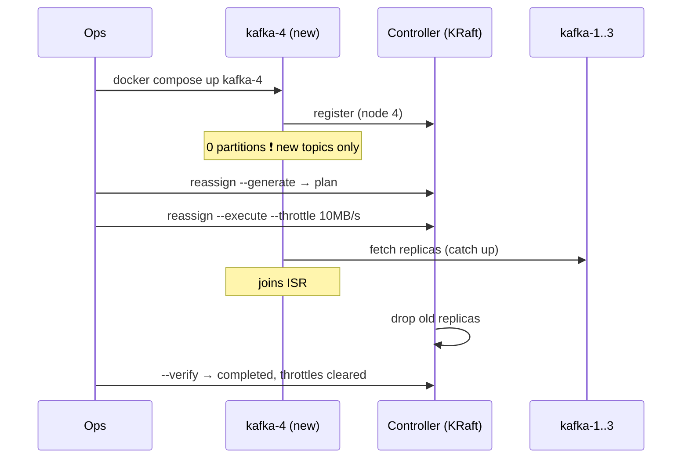

# 35 · Scale Out: Brokers (Docker lab)

> broker جديد بينضم للـ cluster **فاضي**. Kafka ما بتنقل الـ partitions الموجودة لحالها — لازم **reassignment**.



## 1) شغّل broker رابع
```bash
docker compose -f docker/docker-compose.yml -f docker/docker-compose.scale.yml -p kafka-learn up -d kafka-4
```
```yaml
kafka-4:
  environment:
    CLUSTER_ID: "4L6g3nShT-eMCtK--X86sw"   # نفس الـ cluster
    KAFKA_NODE_ID: 4                       # id جديد
    KAFKA_PROCESS_ROLES: "broker"          # مش controller → الـ quorum ما بيتغير
    KAFKA_CONTROLLER_QUORUM_VOTERS: "1@kafka-1:9093,2@kafka-2:9093,3@kafka-3:9093"
```

## 2) Output حقيقي: broker 4 فاضي
```text
kafka-4:19092 (id: 4 ...)  ✅ registered
Partition: 0  Leader: 1  Replicas: 1,2,3     ← no "4" anywhere
Partition: 1  Leader: 2  Replicas: 2,3,1
```

## 3) Reassignment
```bash
docker exec -it kafka-1 bash && cd /opt/kafka/bin
echo '{"version":1,"topics":[{"topic":"demo.orders"}]}' > /tmp/topics.json
./kafka-reassign-partitions.sh --bootstrap-server localhost:19092 \
  --topics-to-move-json-file /tmp/topics.json --broker-list "1,2,3,4" --generate   # → copy "Proposed" to /tmp/plan.json
./kafka-reassign-partitions.sh --bootstrap-server localhost:19092 \
  --reassignment-json-file /tmp/plan.json --execute --throttle 10000000          # 10 MB/s cap
./kafka-reassign-partitions.sh --bootstrap-server localhost:19092 \
  --reassignment-json-file /tmp/plan.json --verify                               # also clears throttles
```

## 4) Output حقيقي: بعد
| Partition | Before | After | Leader |
|---|---|---|---|
| 0 | 1,2,3 | **4**,1,2 | **4** |
| 1 | 2,3,1 | 1,2,3 | 1 |
| 2 | 3,1,2 | 2,3,**4** | 2 |
| 3 | 2,3,1 | 3,**4**,1 | 3 |
| 4 | 3,1,2 | 3,1,**4** | 3 |
| 5 | 1,2,3 | 1,**4**,2 | 1 |

| Broker | Replicas before | after |
|---|---|---|
| 1 / 2 / 3 | 6 / 6 / 6 | 5 / 4 / 4 |
| **4** | **0** | **5** |

## ليش `--throttle`؟
```text
partition 50 GB, no throttle → replication eats all network → producers/consumers slow
throttle 50 MB/s → 50 GB ≈ 17 min, live traffic safe
```

## Scale in (شيل broker)
1. reassign بـ `--broker-list` بدون الـ broker
2. `--verify` = completed
3. `docker stop kafka-4`
> ❌ وقفه أول = under-replicated partitions.

## Prod tools
| Tool | يعني |
|---|---|
| Cruise Control (LinkedIn) | rebalancing تلقائي حسب CPU/disk/network |
| Strimzi (K8s) | `KafkaRebalance` CR + KafkaNodePool scale |

## Controllers؟
- الـ cluster هون **static quorum** (`controller.quorum.voters`) ⇒ عدد الـ controllers ثابت.
- Kafka ≥ 3.9 (KIP-853) **dynamic quorum**: `kafka-metadata-quorum.sh add-controller` — لازم الـ cluster يكون formatted بـ `controller.quorum.bootstrap.servers` من الأول.
- Controllers ما بتحتاج scale للـ throughput؛ 3 (أو 5) كفاية.

← [34-scaling-consumers-partitions.md](34-scaling-consumers-partitions.md) · Next → [36-use-cases.md](../10-wrap-up/36-use-cases.md)
