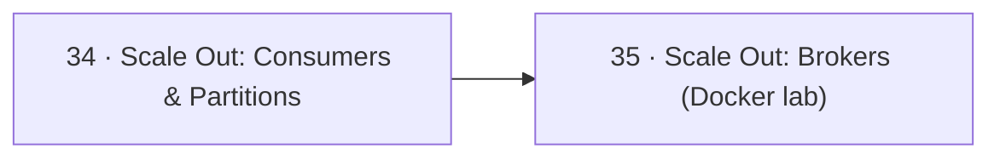

# 📈 09 · Scaling — التوسّع (Scale Out)

> consumers، partitions، brokers — Docker lab بأرقام حقيقية

| # | Idea | One line |
|---|---|---|
| 34 | [Scale Out: Consumers & Partitions](34-scaling-consumers-partitions.md) | Kafka بتتوسع على 4 محاور. **الـ partitions هي السقف**: consumers فعالين بالـ group ≤ عدد partitions. |
| 35 | [Scale Out: Brokers (Docker lab)](35-scaling-brokers.md) | broker جديد بينضم للـ cluster **فاضي**. Kafka ما بتنقل الـ partitions الموجودة لحالها — لازم **reassignment**. |

← [Operations](../08-operations/README.md) · [Map](../../README.md) · [Wrap-up](../10-wrap-up/README.md) →
