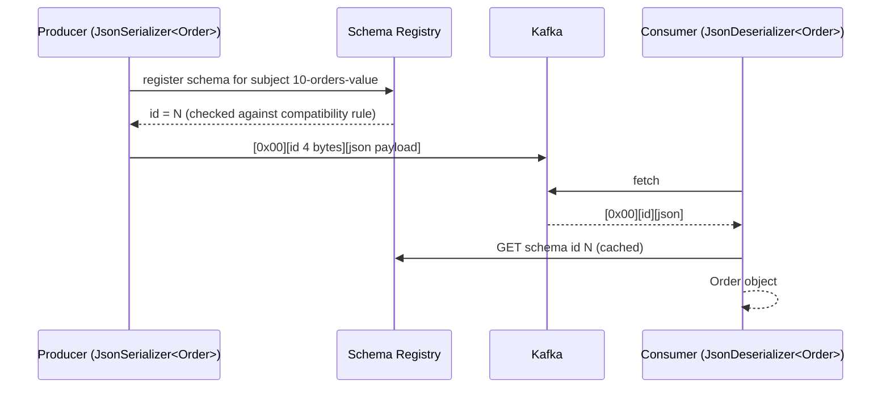

# 10 · Serialization & Schema Registry

**Definition:** **Serialization** turns objects into bytes; a **Schema Registry** stores versioned schemas so producers and consumers agree on those bytes and incompatible changes are blocked.

**Why it matters:** Kafka only stores bytes. Without a contract, one team renames a field and every downstream consumer breaks at runtime.

## Example

<!-- STORY -->

## Diagram



Confluent wire format:

| Byte(s) | Content |
|---|---|
| 0 | magic byte `0x00` |
| 1–4 | schema id (big-endian int) |
| 5… | payload (JSON / Avro / Protobuf) |

Compatibility modes:

| Mode | Allowed change | Upgrade order |
|---|---|---|
| `BACKWARD` (default) | new schema can read old data (delete field, add optional field) | consumers first |
| `FORWARD` | old schema can read new data | producers first |
| `FULL` | both | any |
| `NONE` | anything | 💥 |

## Code

[examples/10-serialization-schema-registry/Program.cs](../examples/10-serialization-schema-registry/Program.cs) — needs `docker compose --profile registry up -d`.

```csharp
using var registry = new CachedSchemaRegistryClient(new SchemaRegistryConfig { Url = "http://localhost:8081" });

using var producer = new ProducerBuilder<string, Order>(new ProducerConfig { BootstrapServers = bootstrap })
    .SetValueSerializer(new JsonSerializer<Order>(registry))
    .Build();

await producer.ProduceAsync(topic, new Message<string, Order> { Key = "o-1", Value = new Order("o-1", "alice", 120.5m) });

public record Order(string Id, string Customer, decimal Amount);
```

<!-- OUTPUT -->

## ✅ Correct vs ❌ wrong usage

| | Usage | Reason |
|---|---|---|
| ✅ | Registry + Avro/Protobuf/JSON Schema for shared topics | Contract enforced at write time |
| ✅ | Add new fields as optional with defaults | Backward compatible |
| ✅ | `AutoRegisterSchemas=false` in production, register in CI | Producers cannot push surprise schemas |
| ❌ | Plain `JsonSerializer.Serialize` strings between teams | No contract; breaks silently |
| ❌ | Change a field type or rename it in place | Incompatible; create a new field or a new topic |

## Pitfalls

1. Subject naming default is `<topic>-value`; multiple event types per topic need `RecordNameStrategy`.
2. Registry down ⇒ new schemas cannot be registered; clients cache known ids.
3. JSON Schema compatibility is stricter/odder than Avro (open vs closed content models).
4. Never mix raw JSON and registry-framed messages in one topic — the deserializer expects the magic byte.

**Next:** [11 · Errors, retries & DLQ](11-errors-retries-dlq.md)
