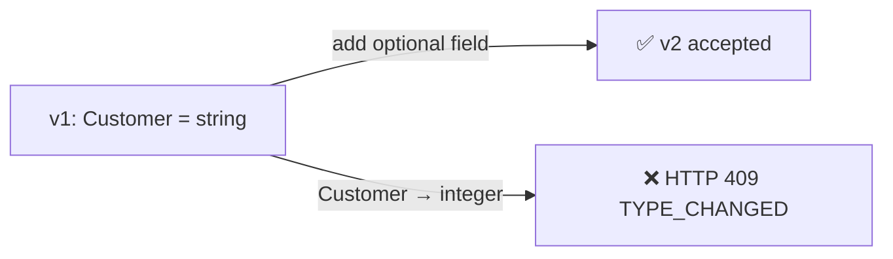
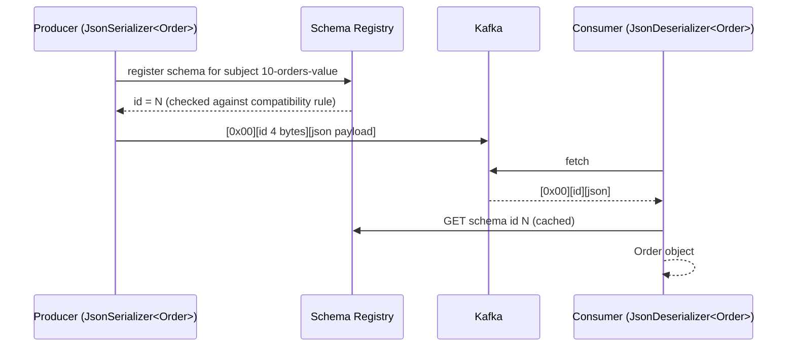

# 10 · Serialization & Schema Registry

**Definition:** **Serialization** turns objects into bytes; a **Schema Registry** stores versioned schemas so producers and consumers agree on those bytes and incompatible changes are blocked.

**Why it matters:** Kafka only stores bytes. Without a contract, one team renames a field and every downstream consumer breaks at runtime.

## Example

`Order("o-1","alice",120.5)` on the wire: **51 bytes** = 5-byte header + JSON.

```
┌──────┬─────────────┬────────────────────────────────────────────────┐
│ 0x00 │ 00 00 00 09 │ {"Id":"o-1","Customer":"alice","Amount":120.5} │
│ magic│ schema id 9 │ JSON payload (46 B)                            │
└──────┴─────────────┴────────────────────────────────────────────────┘
   1 B       4 B
```

The consumer reads id 9, fetches that schema once (cached), and builds the `Order`. The registry decides which next version is allowed (`BACKWARD`):



> Schema ids are global and never reused: after hard-deleting the subject between runs, the id grows (1, 2, … 9) while the version restarts at 1.

## Diagram



Confluent wire format:

| Byte(s) | Content |
|---|---|
| 0 | magic byte `0x00` |
| 1–4 | schema id (big-endian int) |
| 5… | payload (JSON / Avro / Protobuf) |

Compatibility modes:

| Mode | Allowed change | Upgrade order |
|---|---|---|
| `BACKWARD` (default) | new schema can read old data (delete field, add optional field) | consumers first |
| `FORWARD` | old schema can read new data | producers first |
| `FULL` | both | any |
| `NONE` | anything | 💥 |

## Code

[examples/10-serialization-schema-registry/Program.cs](../examples/10-serialization-schema-registry/Program.cs) — needs `docker compose --profile registry up -d`.

```csharp
using var registry = new CachedSchemaRegistryClient(new SchemaRegistryConfig { Url = "http://localhost:8081" });

using var producer = new ProducerBuilder<string, Order>(new ProducerConfig { BootstrapServers = bootstrap })
    .SetValueSerializer(new JsonSerializer<Order>(registry))
    .Build();

await producer.ProduceAsync(topic, new Message<string, Order> { Key = "o-1", Value = new Order("o-1", "alice", 120.5m) });

public record Order(string Id, string Customer, decimal Amount);
```

Output (real run):

```
produced Order o-1 -> p2@3
wire bytes: magic=0x00 schemaId=0x00000009 json={"Id":"o-1","Customer":"alice","Amount":120.5}
subject=10-orders-value version=1 id=9 type=Json
compatibility=Backward
consumed typed object: Order { Id = o-1, Customer = alice, Amount = 120.5 }
breaking schema rejected: HTTP 409 TYPE_CHANGED at #/properties/Customer
```

Generated schema (from `Order` by the serializer):

```json
{
  "$schema": "http://json-schema.org/draft-04/schema#",
  "title": "Order",
  "type": "object",
  "additionalProperties": false,
  "properties": {
    "Id": { "type": "string" },
    "Customer": { "type": "string" },
    "Amount": { "type": "number", "format": "decimal" }
  }
}
```

## ✅ Correct vs ❌ wrong usage

| | Usage | Reason |
|---|---|---|
| ✅ | Registry + Avro/Protobuf/JSON Schema for shared topics | Contract enforced at write time |
| ✅ | Add new fields as optional with defaults | Backward compatible |
| ✅ | `AutoRegisterSchemas=false` in production, register in CI | Producers cannot push surprise schemas |
| ❌ | Plain `JsonSerializer.Serialize` strings between teams | No contract; breaks silently |
| ❌ | Change a field type or rename it in place | Incompatible; create a new field or a new topic |

## Pitfalls

1. Subject naming default is `<topic>-value`; multiple event types per topic need `RecordNameStrategy`.
2. Registry down ⇒ new schemas cannot be registered; clients cache known ids.
3. JSON Schema compatibility is stricter/odder than Avro (open vs closed content models).
4. Never mix raw JSON and registry-framed messages in one topic — the deserializer expects the magic byte.
5. C# `decimal` becomes `{"type":"number","format":"decimal"}`. Measured on cp-schema-registry 8.0.0: changing that field to `"string"` (format kept) returned `is_compatible: true`, while the same change without `format` returned `TYPE_CHANGED`. Test your real schemas with `POST /compatibility/subjects/<subject>/versions/latest?verbose=true` in CI.

**Next:** [11 · Errors, retries & DLQ](11-errors-retries-dlq.md)
