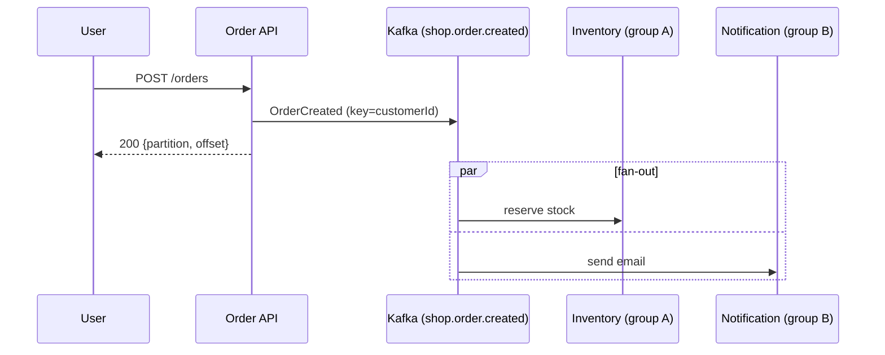
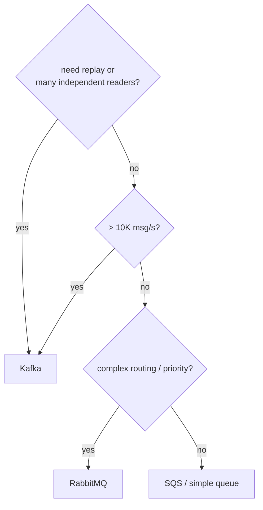

# 36 · Use Cases (ومتى لا)

> Kafka ممتازة لـ **high-volume, ordered, replayable, multi-consumer** events. مش لكل شي.

## Event-Driven Microservices (examples/13)

```bash
dotnet run --project examples/dotnet/13-EventDriven -- api
dotnet run --project examples/dotnet/13-EventDriven -- inventory
dotnet run --project examples/dotnet/13-EventDriven -- notification
```

## Use cases
| Use case | Pattern | Kafka feature |
|---|---|---|
| Microservices events | pub/sub | consumer groups |
| Activity tracking (clicks) | high volume | partitions + batching |
| Log aggregation | many producers → one sink | Connect sink |
| CDC / DB replication | Debezium | compaction |
| Real-time analytics | windows | Streams / Flink |
| Event sourcing | log = truth | retention ∞ + replay |
| Metrics pipeline | fire-and-forget | acks=1 + lz4 |
| Data lake ingestion | Kafka → S3 | Connect S3 sink |

## متى **لا** Kafka
| الحالة | الأنسب |
|---|---|
| < 100 msg/s، team صغير | RabbitMQ / SQS / Postgres queue |
| Request/response (بدك رد فوري) | HTTP / gRPC |
| Routing معقد، priority queues | RabbitMQ |
| Per-message delay / TTL | RabbitMQ / SQS |
| Job queue مع ack per message | SQS / RabbitMQ (أو Share Groups 4.x) |
| Queries على الداتا | Database |

## Decision


Next → [37-anti-patterns.md](37-anti-patterns.md)
