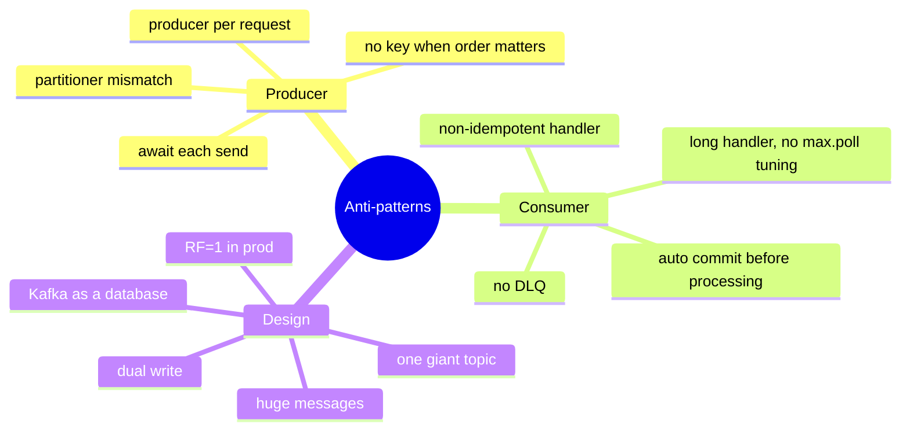

# 37 · Anti-Patterns

> أخطاء بتشوفها بالـ prod. كل وحدة: ❌ الخطأ → ✅ الحل.



## Producer
| ❌ | ✅ |
|---|---|
| `new ProducerBuilder()` بكل HTTP request | singleton producer |
| `await ProduceAsync` بـ loop لـ 10K رسالة | `Produce` + callback + `Flush` أو `Task.WhenAll` |
| key = null لأحداث order lifecycle | key = `orderId` |
| .NET بـ `consistent_random` و Java بـ murmur2 | `Partitioner.Murmur2Random` |
| `EnableIdempotence` مش مفعّل (.NET default false) | `EnableIdempotence = true` |

## Consumer
| ❌ | ✅ |
|---|---|
| auto commit + auto offset store (commit قبل ما تخلص) | `EnableAutoOffsetStore=false` + `StoreOffset` بعد المعالجة |
| handler بياخد 10 دقائق | ارفع `max.poll.interval.ms` أو async pipeline |
| exception ⇒ الـ loop بيوقف / retry للأبد | retry محدود + DLQ |
| `balance += amount` بدون dedup | idempotent consumer (EventId table) |
| consumer بدون `Close()` | `finally { consumer.Close(); }` |
| 12 consumers على 6 partitions | consumers ≤ partitions |

## Design
| ❌ | ✅ |
|---|---|
| Kafka كـ DB (queries, lookups by id) | Kafka → DB/cache view |
| topic واحد `events` لكل شي | topic per event type / aggregate |
| RF=1 أو min.isr=1 بالـ prod | RF=3, min.isr=2 |
| رسائل 10 MB (صور، PDFs) | claim-check: S3 + رابط |
| DB write ثم produce (dual write) | Transactional Outbox |
| `auto.create.topics.enable=true` | إنشاء topics صريح (IaC) |
| تغيير schema بدون compatibility | Schema Registry + BACKWARD |
| زيادة partitions لـ topic فيه ordering by key | خطط العدد من الأول |

## Pitfall حقيقي (شفناه بـ examples/07)
```text
consumer crashed without Close()
→ restart immediately → "no more records" ❓
→ partitions still owned by the dead member for session.timeout.ms (45s)
```
✅ `Close()` دائماً + static membership للـ restarts السريعة.

Next → [38-best-practices.md](38-best-practices.md)
