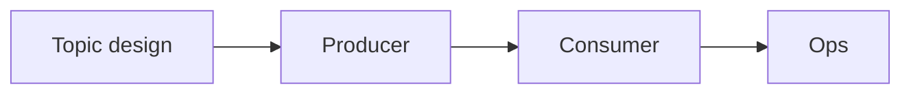

# 38 · Best Practices (Production Checklist)

> Checklist جاهز: topic + producer + consumer + ops.



## Topic
- [ ] Naming: `<domain>.<entity>.<event>` → `shop.order.created`
- [ ] `replication.factor=3`, `min.insync.replicas=2`
- [ ] Partitions محسوبة ([32](../08-operations/32-partition-sizing.md))، multiple of 6
- [ ] `retention.ms` حسب الـ replay المطلوب
- [ ] compacted للـ state topics
- [ ] DLQ topic لكل consumer group مهم
- [ ] Created بالـ IaC (Terraform / script)، مش auto-create

## Producer (.NET)
```csharp
new ProducerConfig
{
    BootstrapServers = "b1:9093,b2:9093,b3:9093",
    Acks = Acks.All,
    EnableIdempotence = true,
    LingerMs = 5,                              // 5-20
    CompressionType = CompressionType.Lz4,     // or Zstd
    Partitioner = Partitioner.Murmur2Random,
    MessageTimeoutMs = 120_000,
    ClientId = "orders-api"
};
```
- [ ] Singleton + `Flush()` على shutdown
- [ ] Key = aggregate id
- [ ] Headers: `event-type`, `event-id`, `correlation-id`, `traceparent`
- [ ] Outbox لو فيه DB write

## Consumer (.NET)
```csharp
new ConsumerConfig
{
    GroupId = "inventory-service",
    EnableAutoCommit = true,
    EnableAutoOffsetStore = false,             // StoreOffset after success
    AutoOffsetReset = AutoOffsetReset.Earliest,
    PartitionAssignmentStrategy = PartitionAssignmentStrategy.CooperativeSticky,
    GroupInstanceId = Environment.GetEnvironmentVariable("POD_NAME"),   // static membership
    IsolationLevel = IsolationLevel.ReadCommitted,
    MaxPollIntervalMs = 300_000
};
```
- [ ] Idempotent handler (EventId dedup)
- [ ] Retry محدود + DLQ + alert
- [ ] `Close()` بالـ `finally`
- [ ] Consume loop على thread منفصل بالـ BackgroundService

## Ops
- [ ] 3+ brokers على 3 AZs (`broker.rack`)
- [ ] 3 dedicated KRaft controllers
- [ ] `unclean.leader.election.enable=false`
- [ ] Alerts: lag, URP, offline partitions, disk > 80%
- [ ] SASL_SSL + ACLs
- [ ] JVM heap 6GB، الباقي page cache
- [ ] Rolling upgrades broker by broker

## Numbers للبدء
| | Value |
|---|---|
| Brokers | 3 |
| Partitions / topic | 6-12 |
| RF / min.isr | 3 / 2 |
| linger.ms | 5-20 |
| Retention | 7 days |

Next → [39-interview-questions.md](39-interview-questions.md)
