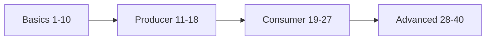

# 39 · Self-Test (أسئلة مقابلات)

> غطّي الجواب، جاوب بصوت عالي، بعدين افتح. كل سؤال مربوط بالـ doc.

## Basics

1. ليش Kafka أسرع من queue تقليدي؟
sequential I/O + page cache + zero-copy + batching/compression. [22](../06-storage/22-storage-internals.md)

2. الفرق بين topic و partition؟
topic منطقي، partition = log فيزيائي؛ وحدة الترتيب والتوازي. [06](../01-foundations/06-partitions.md)

3. هل الترتيب مضمون بالـ topic؟
لا، per partition فقط. [06](../01-foundations/06-partitions.md)

4. شو بيصير للرسالة بعد ما تنقرأ؟
ولا شي — بتبقى لحد retention/compaction. [02](../01-foundations/02-commit-log.md)

5. شو دور الـ controller بـ KRaft؟
يدير metadata (leaders, topics, ISR) عبر Raft quorum بـ `__cluster_metadata`. [04](../01-foundations/04-kraft.md)

6. ليش 3 controllers مش 2؟
Raft يحتاج majority؛ 2 ما بتتحمل ولا فشل، 3 بتتحمل 1. [04](../01-foundations/04-kraft.md)

7. advertised.listeners لشو؟
العنوان اللي الـ broker يعطيه للـ clients بالـ metadata. [03](../01-foundations/03-broker-cluster.md)

8. الفرق بين LEO و HW؟
LEO = الـ offset الجاي بالـ replica؛ HW = min(LEO) عبر الـ ISR = حد القراءة. [10](../02-replication/10-isr-hw.md)

9. شو الـ ISR؟ ومتى replica بتطلع منه؟
replicas لاحقة؛ بتطلع لو تأخرت > replica.lag.time.max.ms (30s). [10](../02-replication/10-isr-hw.md)

10. RF=3, min.isr=2، وقع broker. بتقدر تكتب acks=all؟ ووقع التاني؟
أول وقوع ✅ (ISR=2)، التاني ❌ NOT_ENOUGH_REPLICAS. [10](../02-replication/10-isr-hw.md)

## Producer

11. acks=1 — متى بتضيع داتا؟
leader ack ومات قبل ما الـ followers ينسخوا. [12](../03-producer/12-acks-durability.md)

12. كيف idempotent producer بيمنع التكرار؟
PID + sequence per partition؛ الـ broker بيرفض seq مكرر. [13](../03-producer/13-idempotent-producer.md)

13. هل idempotence بتحمي من restart للـ app؟
لا، PID جديد. بدك transactional.id. [13](../03-producer/13-idempotent-producer.md)

14. linger.ms شو بيعمل؟
ينتظر ليعبي batch → throughput أعلى، latency أعلى. [11](../03-producer/11-producer-internals.md)

15. ليش .NET و Java ممكن يكتبوا نفس الـ key لـ partitions مختلفة؟
librdkafka default = consistent_random (CRC32)، Java = murmur2. [14](../03-producer/14-partitioning-keys.md)

16. شو بيصير لو زدت partitions؟
hash % N يتغير → keys تنتقل → ترتيب الـ key ينكسر. [06](../01-foundations/06-partitions.md)

17. hot partition — شو السبب والحل؟
key skewed؛ key أدق أو salting. [14](../03-producer/14-partitioning-keys.md)

18. dual-write problem وحله؟
DB + Kafka بدون transaction مشتركة؛ Outbox + relay/CDC. [25](../07-integration-patterns/25-outbox-pattern.md)

## Consumer

19. 6 partitions و 8 consumers بنفس الـ group؟
6 شغالين، 2 idle. [16](../04-consumer/16-consumer-groups.md)

20. كيف تعمل fan-out لنفس الـ event؟
group.id مختلف لكل service. [16](../04-consumer/16-consumer-groups.md)

21. شو بيطلق rebalance؟
join/leave/death/max.poll exceeded/partitions change. [17](../04-consumer/17-rebalancing.md)

22. eager vs cooperative؟
eager يسحب كل شي؛ cooperative بس الـ partitions المنقولة. [17](../04-consumer/17-rebalancing.md)

23. static membership لشو؟
restart سريع بدون rebalance (GroupInstanceId). [17](../04-consumer/17-rebalancing.md)

24. session.timeout vs max.poll.interval؟
الأول heartbeats (process حي)، التاني poll calls (loop مش عالق). [15](../04-consumer/15-consumer-poll-loop.md)

25. commit(offset 41) شو بيحفظ؟
42 = next to read. [07](../01-foundations/07-offsets.md)

26. وين بتنحفظ الـ offsets؟
`__consumer_offsets` (compacted, 50 partitions). [18](../04-consumer/18-offset-commit.md)

27. auto.offset.reset متى بيطبق؟
لما ما في committed offset أو خارج الـ range. [07](../01-foundations/07-offsets.md)

## Advanced

28. at-least-once vs at-most-once — بالكود؟
commit بعد المعالجة vs قبلها. [19](../05-delivery-semantics/19-delivery-semantics.md)

29. كيف تعمل exactly-once لـ Kafka→DB؟
at-least-once + dedup table بنفس DB transaction. [19](../05-delivery-semantics/19-delivery-semantics.md)

30. SendOffsetsToTransaction لشو؟
يخلي commit الـ input offset جزء من نفس transaction الـ output. [20](../05-delivery-semantics/20-transactions-eos.md)

31. zombie fencing؟
epoch يزيد مع كل InitTransactions؛ القديم مرفوض. [20](../05-delivery-semantics/20-transactions-eos.md)

32. read_committed شو بيشوف؟
committed فقط، لحد LSO. [20](../05-delivery-semantics/20-transactions-eos.md)

33. compaction شو بيضمن؟
آخر value لكل key على الأقل؛ tombstone يحذف. [21](../06-storage/21-retention-compaction.md)

34. ليش record ممكن يعيش أكثر من retention.ms؟
الحذف per segment، والـ active segment ما بينحذف. [21](../06-storage/21-retention-compaction.md)

35. poison pill — شو هو وكيف تتعامل؟
record ما بتنقرأ/بتفشل دائماً؛ DLQ ولا توقف الـ partition. [24](../07-integration-patterns/24-error-handling-dlq.md)

36. BACKWARD compatibility؟
consumer الجديد يقرأ داتا قديمة؛ إضافة field مع default. [23](../07-integration-patterns/23-serialization-schema.md)

37. كيف تحسب عدد partitions؟
max(T/Tp, T/Tc) × growth. [32](../08-operations/32-partition-sizing.md)

38. Share groups شو بتحل؟
أكثر من consumer per partition + ack per record (queue semantics). [33](../08-operations/33-kafka-4x-new-features.md)

39. أهم metric للمراقبة؟
consumer lag، ثم URP و offline partitions. [29](../08-operations/29-monitoring.md)

40. ليش ما نستخدم Kafka كـ DB؟
ما في index/query by id؛ access sequential فقط. [37](37-anti-patterns.md)

← Back to [README](../../README.md)
