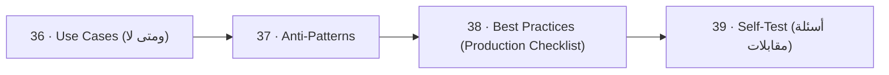

# 🏁 10 · Wrap-up — الخلاصة

> use cases، anti-patterns، best practices، 40 سؤال مقابلة

| # | Idea | One line |
|---|---|---|
| 36 | [Use Cases (ومتى لا)](36-use-cases.md) | Kafka ممتازة لـ **high-volume, ordered, replayable, multi-consumer** events. مش لكل شي. |
| 37 | [Anti-Patterns](37-anti-patterns.md) | أخطاء بتشوفها بالـ prod. كل وحدة: ❌ الخطأ → ✅ الحل. |
| 38 | [Best Practices (Production Checklist)](38-best-practices.md) | Checklist جاهز: topic + producer + consumer + ops. |
| 39 | [Self-Test (أسئلة مقابلات)](39-interview-questions.md) | غطّي الجواب، جاوب بصوت عالي، بعدين افتح. كل سؤال مربوط بالـ doc. |

← [Scaling](../09-scaling/README.md) · [Map](../../README.md)
