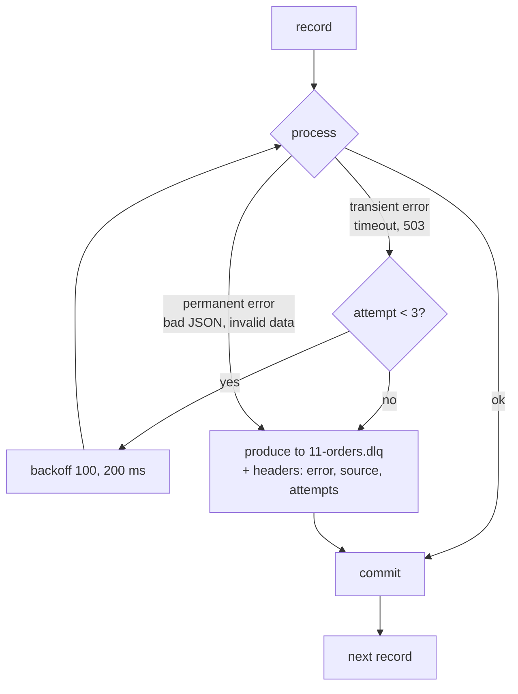

# 11 · Errors, retries & dead letter queue

**Definition:** A **dead letter queue (DLQ)** is a separate topic where a consumer parks records it cannot process, so one bad record does not block the partition.

**Why it matters:** A partition is ordered: if record 1 always throws and you never commit, the consumer is stuck forever ("poison pill").

## Example

```
Initial data:
  topic                : 11-orders, 5 records
  records              : ok · "not-json" · amount -5 · flaky ×2 · flaky ×9
  max attempts         : 3, backoff 100 ms → 200 ms

Commands:
  offset 0             : OK on attempt 1
  offset 1             : JsonReaderException → DLQ (attempt 1)
  offset 2             : ArgumentException → DLQ (attempt 1)
  offset 3             : timeout, timeout, OK on attempt 3
  offset 4             : timeout ×3 → DLQ (attempt 3)

Result:
  processed            : 2 of 5
  in 11-orders.dlq     : 3, each with error / source / attempts headers
  consumer             : never stuck; all 5 offsets committed
```

## Diagram



| Error type | Example | Action |
|---|---|---|
| Transient | DB timeout, HTTP 503 | Retry with backoff |
| Permanent | invalid JSON, negative amount | DLQ immediately |
| Retries exhausted | service down for minutes | DLQ (or pause the partition) |

## Code

[examples/11-errors-retries-dlq/Program.cs](../examples/11-errors-retries-dlq/Program.cs)

```csharp
try
{
    Process(record);

    break;
}
catch (TransientException ex) when (attempt < maxAttempts)
{
    await Task.Delay(TimeSpan.FromMilliseconds(100 * Math.Pow(2, attempt - 1)));
}
catch (Exception ex)
{
    await SendToDlq(record, ex, attempt);

    break;
}
// commit only after the record is either processed or safely in the DLQ
consumer.Commit(record);
```

Output:

```text
offset 0: OK (attempt 1)
offset 1: -> DLQ after 1 attempt(s): JsonReaderException: 'not-json' is an invalid JSON literal. Expected the literal 'null'. LineNumber: 0 | BytePositionInLine: 1.
offset 2: -> DLQ after 1 attempt(s): ArgumentException: amount must be positive
offset 3: transient error "payment service timeout #1" -> retry in 100 ms
offset 3: transient error "payment service timeout #2" -> retry in 200 ms
offset 3: OK (attempt 3)
offset 4: transient error "payment service timeout #1" -> retry in 100 ms
offset 4: transient error "payment service timeout #2" -> retry in 200 ms
offset 4: -> DLQ after 3 attempt(s): TransientException: payment service timeout #3

DLQ value=not-json | error=JsonReaderException source=11-orders/0/1 attempts=1
DLQ value={"id":3,"amount":-5} | error=ArgumentException source=11-orders/0/2 attempts=1
DLQ value={"id":5,"amount":90,"flaky":9} | error=TransientException source=11-orders/0/4 attempts=3
```

## ✅ Correct vs ❌ wrong usage

| | Usage | Reason |
|---|---|---|
| ✅ | Classify errors: retry transient, DLQ permanent | No endless retry of bad data |
| ✅ | Put error, source topic/partition/offset in DLQ headers | Easy debugging and replay |
| ✅ | Alert on DLQ growth; have a replay tool | DLQ is not a trash can |
| ❌ | `catch { }` and commit | Silent data loss |
| ❌ | Retry forever in-line | Partition stalls, `max.poll.interval.ms` exceeded, rebalance loop |

## Pitfalls

1. Long in-line retries block the whole partition; for long outages use retry topics (`orders.retry.1m`, `orders.retry.10m`) or `Pause()`.
2. Sending to the DLQ can fail too — only commit after the DLQ write is acknowledged.
3. DLQ breaks ordering for that key; decide if later events of the same key must also be parked.
4. Deserialization errors surface as `ConsumeException` *before* your handler — catch them in the loop too.

**Next:** [12 · Replication & ISR](12-replication-isr.md)
