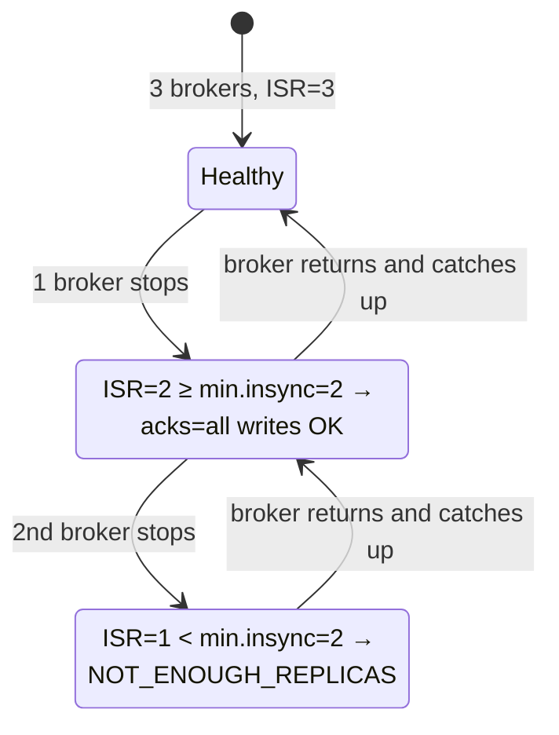
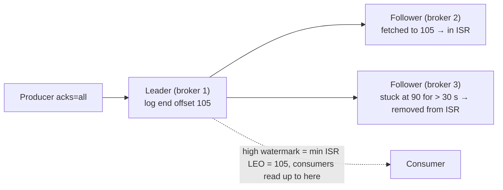

# 12 · Replication & ISR

**Definition:** Each partition has **RF** copies (replicas) on different brokers: one **leader** serves reads/writes, **followers** copy it; followers that are caught up form the **ISR** (in-sync replica set).

**Why it matters:** Brokers die. With RF=3 and `min.insync.replicas=2`, Kafka keeps accepting `acks=all` writes with one broker down and **refuses** writes (instead of risking loss) with two down.

## Example

Topic `12-bank-transfers`, RF 3, `min.insync.replicas=2`, producer `acks=all`:

| Step | Brokers up | ISR | Write | Why |
|---|---|---|---|---|
| 1 | 1 2 3 | [1,2,3] | ✅ offset 0 | 3 ≥ 2 |
| 2 | 1 2 (stop kafka-3) | [1,2] | ✅ offset 1 | 2 ≥ 2 |
| 3 | 1 (stop kafka-2) | [1] | ❌ NotEnoughReplicas | 1 < 2 |
| 4 | 1 2 3 (start both) | [1,2,3] | ✅ offset 2 | followers caught up |

Writes stopped while only one copy existed; **0 records lost**.

## Diagram





| Term | Meaning |
|---|---|
| LEO (log end offset) | Last offset + 1 on one replica |
| High watermark | Highest offset copied to all ISR → visible to consumers |
| `replica.lag.time.max.ms` | Follower not caught up for this long (30 s) → leaves ISR |
| `unclean.leader.election.enable` | Allow an out-of-sync replica to become leader (data loss) — keep `false` |

## Code

[examples/12-replication-isr/Program.cs](../examples/12-replication-isr/Program.cs)

```csharp
// no client retries, so the broker's error is shown instead of a timeout
var config = new ProducerConfig { BootstrapServers = bootstrap, Acks = Acks.All, MessageTimeoutMs = 5000, MessageSendMaxRetries = 0 };

var spec = new TopicSpecification
{
    Name = topic,
    NumPartitions = 3,
    ReplicationFactor = 3,
    Configs = new() { ["min.insync.replicas"] = "2" }
};

foreach (var p in description.TopicDescriptions[0].Partitions)
{
    Console.WriteLine($"partition {p.Partition}: leader={leader} replicas=[...] isr=[...]");
}
```

Lab script (real run; `docker stop/start` executed between runs):

Output:

```text
$ dotnet run create
alive brokers: [1,2,3]
partition 0: leader=2 replicas=[2,3,1] isr=[2,3,1]
partition 1: leader=3 replicas=[3,1,2] isr=[3,1,2]
partition 2: leader=1 replicas=[1,2,3] isr=[1,2,3]
acks=all write -> OK partition 0 offset 0

$ docker stop kafka-3
$ dotnet run
alive brokers: [1,2]
partition 0: leader=2 replicas=[2,3,1] isr=[2,1]
partition 1: leader=1 replicas=[3,1,2] isr=[1,2]
partition 2: leader=1 replicas=[1,2,3] isr=[1,2]
acks=all write -> OK partition 0 offset 1

$ docker stop kafka-2
$ dotnet run
alive brokers: [1]
partition 0: leader=1 replicas=[2,3,1] isr=[1]
partition 1: leader=1 replicas=[3,1,2] isr=[1]
partition 2: leader=1 replicas=[1,2,3] isr=[1]
acks=all write -> FAILED: NotEnoughReplicas (Broker: Not enough in-sync replicas)

$ docker start kafka-2 kafka-3
$ dotnet run
alive brokers: [1,2,3]
partition 0: leader=1 replicas=[2,3,1] isr=[1,2,3]
partition 1: leader=1 replicas=[3,1,2] isr=[1,2,3]
partition 2: leader=1 replicas=[1,2,3] isr=[1,2,3]
acks=all write -> OK partition 0 offset 2
```

## ✅ Correct vs ❌ wrong usage

| | Usage | Reason |
|---|---|---|
| ✅ | RF=3, `min.insync.replicas=2`, `acks=all` | Tolerates 1 failure, no acknowledged-write loss |
| ✅ | Spread brokers across racks/AZs (`broker.rack`) | One rack outage ≠ partition outage |
| ❌ | RF=3 but `min.insync.replicas=3` | Any single broker restart blocks all writes |
| ❌ | RF=1 in production | One disk failure = data gone |
| ❌ | `unclean.leader.election.enable=true` for payments | Availability over consistency → acknowledged writes can vanish |

## Pitfalls

1. Reads go to the leader by default; follower fetching needs `client.rack` + rack-aware replica selector.
2. A restarted broker is **not** leader again until preferred-leader election runs (automatic every 5 min by default).
3. `acks=1` + leader crash = loss even with RF=3.
4. Replication traffic doubles/triples network usage; size the network for RF × produce rate.
5. `NOT_ENOUGH_REPLICAS` is retriable: with default retries the client keeps trying until `message.timeout.ms` and you only see `Local_MsgTimedOut`. In this combined-mode lab, 2 of 3 nodes down also means the KRaft quorum has lost its majority.

After the restart all leaders are on broker 1 until the automatic preferred-leader election (every 5 min) moves them back.

**Next:** [13 · Retention & compaction](13-retention-compaction.md)
