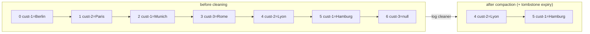

# 13 · Retention & log compaction

**Definition:** **Retention** (`cleanup.policy=delete`) drops whole old segments by time/size; **compaction** (`cleanup.policy=compact`) keeps only the **latest record per key**.

**Why it matters:** Events like "clicks" can expire after 7 days, but "current address of customer X" must live forever without the topic growing forever.

## Example

Compaction keeps the **latest value per key**; a `null` value (tombstone) deletes the key. Offsets are never renumbered.

```
before   offset: 0         1        2         3       4        5           6
                 cust-1    cust-2   cust-1    cust-3  cust-2   cust-1      cust-3
                 Berlin    Paris    Munich    Rome    Lyon     Hamburg     null (tombstone)
                 ✗ old     ✗ old    ✗ old     ✗ del   ✓        ✓           ✗ expired

after (~27 s)    offset 4: cust-2 = Lyon     offset 5: cust-1 = Hamburg
```

7 records → 2. `cust-3` is gone because of its tombstone.

## Diagram



| Setting | Default | Meaning |
|---|---|---|
| `cleanup.policy` | `delete` | `delete`, `compact`, or `compact,delete` |
| `retention.ms` | 7 days | Delete segments older than this |
| `retention.bytes` | -1 (unlimited) | Max size per **partition** |
| `segment.ms` / `segment.bytes` | 7 days / 1 GiB | When the active segment rolls (only closed segments are cleaned) |
| `min.cleanable.dirty.ratio` | 0.5 | Compact when ≥ 50 % of the log is "dirty" |
| `delete.retention.ms` | 1 day | How long tombstones stay visible |

## Code

[examples/13-retention-compaction/Program.cs](../examples/13-retention-compaction/Program.cs)

```csharp
Configs = new()
{
    ["cleanup.policy"] = "compact",
    ["segment.ms"] = "1000",
    ["min.cleanable.dirty.ratio"] = "0.01",
    ["delete.retention.ms"] = "1000"
};

// a null value is a tombstone: "delete this key"
await producer.ProduceAsync(topic, new Message<string, string?> { Key = key, Value = value });
```

Output:

```text
before compaction:
  offset 0: cust-1 = Berlin
  offset 1: cust-2 = Paris
  offset 2: cust-1 = Munich
  offset 3: cust-3 = Rome
  offset 4: cust-2 = Lyon
  offset 5: cust-1 = Hamburg
  offset 6: cust-3 = <tombstone>
waiting for the log cleaner ...
after compaction:
  offset 4: cust-2 = Lyon
  offset 5: cust-1 = Hamburg
```

Offsets are **kept** (4, 5 …) — compaction removes records, it never renumbers.

## ✅ Correct vs ❌ wrong usage

| | Usage | Reason |
|---|---|---|
| ✅ | Compacted topic for "latest state per key" (config, profiles, KTable changelogs) | Bounded size, full current state |
| ✅ | Null value (tombstone) to delete a key | Key disappears after `delete.retention.ms` |
| ❌ | Compacted topic with null keys | Rejected: compaction needs keys |
| ❌ | Expect compaction to be immediate | Active segment is never compacted; cleaner runs on its own schedule |
| ❌ | `retention.ms=-1` + `delete` "to be safe" | Disk fills up |

## Pitfalls

1. Consumers can still see old values of a key until the cleaner runs — compaction is "eventually latest".
2. Retention removes whole segments: with 1 GiB segments, data can live much longer than `retention.ms`.
3. Retention is per partition; total size = `retention.bytes × partitions × RF`.
4. Tombstones must be read within `delete.retention.ms` by consumers rebuilding state, or they miss the delete.

**Next:** [14 · Storage internals](14-storage-internals.md)
