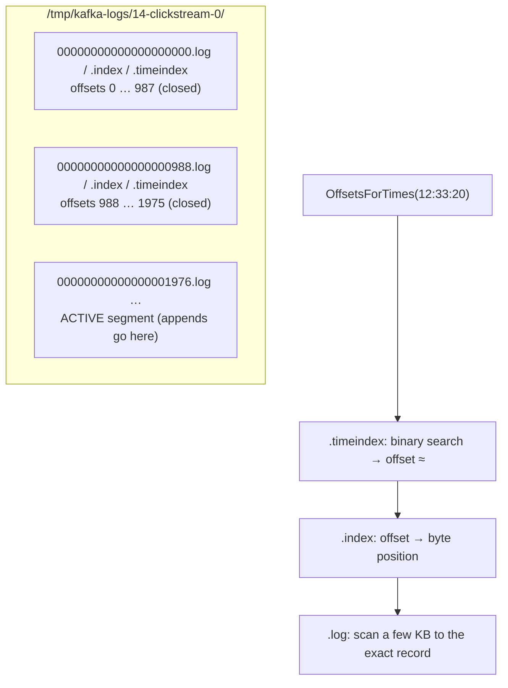
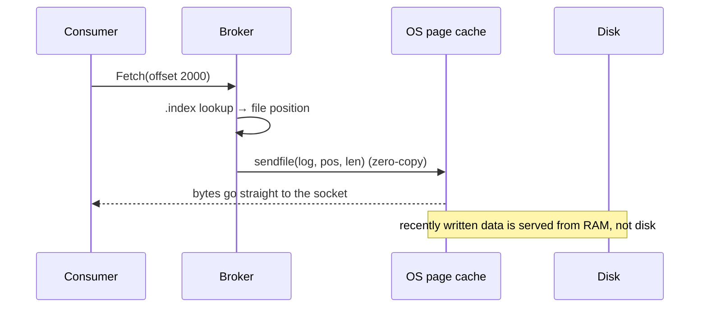

# 14 · Storage internals

**Definition:** Each partition is a directory of **segments**; each segment is a `.log` file of record batches plus a sparse `.index` (offset → byte position) and `.timeindex` (timestamp → offset).

**Why it matters:** This layout is why Kafka is fast (sequential appends, zero-copy reads, page cache) and explains retention, seek-by-time, and disk usage.

## Example

```
Initial data:
  topic                : 14-clickstream, 1 partition, segment.bytes = 1 MiB
  records              : 3000 × 1000-byte values, event time 12:00:00 + 1 s each

Commands:
  ls partition dir     : segments 00…000.log, 00…988.log, 00…1976.log
  dump 00…000.log      : 1 batch, offsets 0–987, 988 records, 999,843 bytes
  OffsetsForTimes      : 12:10:00 → 600 · 12:33:20 → 2000 · 12:49:59 → 2999

Result:
  segments             : 3 files (988 + 988 + 1024 records)
  file name            : = first offset in that segment
```

## Diagram





## Code

[examples/14-storage-internals/Program.cs](../examples/14-storage-internals/Program.cs)

```csharp
// 1 MiB segments (the minimum in Kafka 4.x) so 3000 x 1 KiB records span several files
Configs = new() { ["segment.bytes"] = "1048576" };

var message = new Message<Null, string> { Value = payload, Timestamp = new Timestamp(baseTime.AddSeconds(i)) };

// the broker binary-searches the .timeindex, then the .index, then scans the .log
var found = consumer.OffsetsForTimes([new TopicPartitionTimestamp(topic, 0, new Timestamp(time))], TimeSpan.FromSeconds(5));
```

Output:

```text
written 3000 records, offsets 0..2999
first record at or after 12:00:00 -> offset 0
first record at or after 12:10:00 -> offset 600
first record at or after 12:33:20 -> offset 2000
first record at or after 12:49:59 -> offset 2999
```

```text
$ docker exec kafka-1 ls -l /tmp/kafka-logs/14-clickstream-0
total 3008
-rw-r--r-- 1 appuser appuser        0 Nov  1 15:11 00000000000000000000.index
-rw-r--r-- 1 appuser appuser   999843 Nov  1 15:11 00000000000000000000.log
-rw-r--r-- 1 appuser appuser       12 Nov  1 15:11 00000000000000000000.timeindex
-rw-r--r-- 1 appuser appuser        0 Nov  1 15:11 00000000000000000988.index
-rw-r--r-- 1 appuser appuser   999843 Nov  1 15:11 00000000000000000988.log
-rw-r--r-- 1 appuser appuser       10 Nov  1 15:11 00000000000000000988.snapshot
-rw-r--r-- 1 appuser appuser       12 Nov  1 15:11 00000000000000000988.timeindex
-rw-r--r-- 1 appuser appuser 10485760 Nov  1 15:11 00000000000000001976.index
-rw-r--r-- 1 appuser appuser  1036290 Nov  1 15:11 00000000000000001976.log
-rw-r--r-- 1 appuser appuser       10 Nov  1 15:11 00000000000000001976.snapshot
-rw-r--r-- 1 appuser appuser 10485756 Nov  1 15:11 00000000000000001976.timeindex
-rw-r--r-- 1 appuser appuser        8 Nov  1 15:11 leader-epoch-checkpoint
-rw-r--r-- 1 appuser appuser       43 Nov  1 15:11 partition.metadata

$ docker exec kafka-1 /opt/kafka/bin/kafka-dump-log.sh --files /tmp/kafka-logs/14-clickstream-0/00000000000000000000.log | head -4
Dumping /tmp/kafka-logs/14-clickstream-0/00000000000000000000.log
Log starting offset: 0
baseOffset: 0 lastOffset: 987 count: 988 baseSequence: -1 lastSequence: -1 producerId: -1 producerEpoch: -1 partitionLeaderEpoch: 0 isTransactional: false isControl: false deleteHorizonMs: OptionalLong.empty position: 0 CreateTime: 1767269787000 size: 999843 magic: 2 compresscodec: none crc: 2975019690 isvalid: true

$ docker exec kafka-1 /opt/kafka/bin/kafka-dump-log.sh --files /tmp/kafka-logs/14-clickstream-0/00000000000000000000.index | head -4
Dumping /tmp/kafka-logs/14-clickstream-0/00000000000000000000.index
/tmp/kafka-logs/14-clickstream-0/00000000000000000000.index is empty.

$ docker exec kafka-1 /opt/kafka/bin/kafka-dump-log.sh --files /tmp/kafka-logs/14-clickstream-0/00000000000000000000.timeindex | head -4
Dumping /tmp/kafka-logs/14-clickstream-0/00000000000000000000.timeindex
timestamp: 1767269787000 offset: 987
```

What the files show:

| Observation | Why |
|---|---|
| Segment names 0, 988, 1976 | A file is named after its **first offset** |
| One batch of 988 records per closed segment | librdkafka sent ~1 MB batches; one batch fills a 1 MiB segment |
| Closed `.index` files are empty (0 bytes) | The index is **sparse**: one entry per `index.interval.bytes` (4096) *between batches*; a segment with one batch needs none |
| Active `.index` / `.timeindex` are 10 MiB | Pre-allocated, trimmed when the segment closes |
| `.snapshot` files | Producer-state snapshots (idempotence / transactions) |

## ✅ Correct vs ❌ wrong usage

| | Usage | Reason |
|---|---|---|
| ✅ | `OffsetsForTimes` to replay "since 09:00" | Index lookup, no scanning |
| ✅ | Leave lots of RAM to the OS page cache | Hot reads never touch disk |
| ❌ | Give the JVM 32 GB heap "for speed" | Steals page cache; Kafka needs ~6 GB heap at most |
| ❌ | Tiny segments in production | Thousands of files and open handles |

## Pitfalls

1. Producer-set timestamps can be in the future/past; `message.timestamp.type=LogAppendTime` makes the broker set them.
2. Disk usage ≠ sum of message sizes: batch headers, indexes, RF copies.
3. Compressed batches stay compressed on disk and on the wire to consumers.
4. Do not put Kafka logs on network file systems (NFS): mmap + fsync semantics break.

**Next:** [15 · KRaft & metadata](15-kraft-metadata.md)
