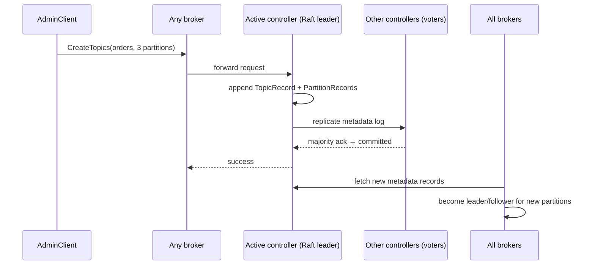
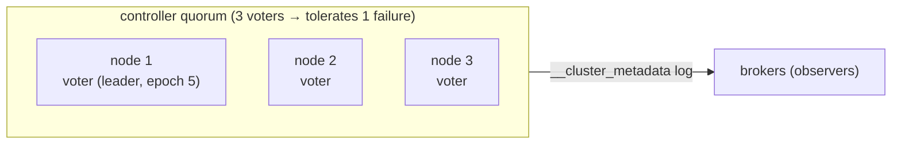

# 15 · KRaft & cluster metadata

**Definition:** **KRaft** is Kafka's built-in Raft consensus: a quorum of **controllers** stores all cluster metadata (topics, partitions, leaders, configs, ACLs) as events in the internal log `__cluster_metadata`.

**Why it matters:** Kafka 4.0 removed ZooKeeper. Understanding the controller quorum explains failover speed, why you need 3 or 5 controllers, and how brokers learn about leader changes.

## Example

```
Initial data:
  voters               : 1@kafka-1:9093, 2@kafka-2:9093, 3@kafka-3:9093
  roles                : broker,controller on every node

Commands:
  kafka-metadata-quorum describe --status      : LeaderId 1, LeaderEpoch 5, HighWatermark 1815
  kafka-metadata-quorum describe --replication : nodes 1,2,3 at LogEndOffset 1821, lag 0
  DescribeClusterAsync (C#)                    : "controller" 2 (random broker in KRaft)

Result:
  quorum               : 3 voters, majority = 2 → tolerates 1 controller down
  metadata lag         : 0 records on all followers
```

## Diagram





| ZooKeeper era | KRaft era |
|---|---|
| Separate ZK ensemble to run | Built into Kafka |
| Controller reloads all state from ZK on failover (slow) | Standby controllers already have the log (fast) |
| ~200k partitions practical limit | Millions of partitions |

## Code

[examples/15-kraft-metadata/Program.cs](../examples/15-kraft-metadata/Program.cs)

```csharp
var cluster = await admin.DescribeClusterAsync();

// in KRaft, brokers answer this with a RANDOM broker id; the real leader comes from kafka-metadata-quorum.sh
Console.WriteLine($"DescribeCluster    = controller node {cluster.Controller?.Id} (random broker in KRaft)");

var configs = await admin.DescribeConfigsAsync(resources);
```

Output:

```text
cluster.id         = MkU3OEVBNTcwNTJENDM2Qk
DescribeCluster    = controller node 2 (random broker in KRaft)

node 1:
  node.id                    = 1
  process.roles              = broker,controller
  controller.quorum.voters   = 1@kafka-1:9093,2@kafka-2:9093,3@kafka-3:9093
  controller.listener.names  = CONTROLLER
  advertised.listeners       = INTERNAL://kafka-1:29092,EXTERNAL://localhost:9092

node 2:
  node.id                    = 2
  process.roles              = broker,controller
  controller.quorum.voters   = 1@kafka-1:9093,2@kafka-2:9093,3@kafka-3:9093
  controller.listener.names  = CONTROLLER
  advertised.listeners       = INTERNAL://kafka-2:29092,EXTERNAL://localhost:9094

node 3:
  node.id                    = 3
  process.roles              = broker,controller
  controller.quorum.voters   = 1@kafka-1:9093,2@kafka-2:9093,3@kafka-3:9093
  controller.listener.names  = CONTROLLER
  advertised.listeners       = INTERNAL://kafka-3:29092,EXTERNAL://localhost:9096
```

```text
$ docker exec kafka-1 /opt/kafka/bin/kafka-metadata-quorum.sh --bootstrap-server localhost:9092 describe --status
[2026-11-01 15:13:13,219] WARN [AdminClient clientId=adminclient-1] Connection to node 2 (localhost/127.0.0.1:9094) could not be established. Node may not be available. (org.apache.kafka.clients.NetworkClient)
ClusterId:              MkU3OEVBNTcwNTJENDM2Qk
LeaderId:               1
LeaderEpoch:            5
HighWatermark:          1815
MaxFollowerLag:         0
MaxFollowerLagTimeMs:   0
CurrentVoters:          [{"id": 1, "endpoints": ["CONTROLLER://kafka-1:9093"]}, {"id": 2, "endpoints": ["CONTROLLER://kafka-2:9093"]}, {"id": 3, "endpoints": ["CONTROLLER://kafka-3:9093"]}]
CurrentObservers:       []

$ ... describe --replication
NodeId	DirectoryId           	LogEndOffset	Lag	LastFetchTimestamp	LastCaughtUpTimestamp	Status  	
1     	AAAAAAAAAAAAAAAAAAAAAA	1821        	0  	1793545996583     	1793545996583        	Leader  	
2     	AAAAAAAAAAAAAAAAAAAAAA	1821        	0  	1793545996095     	1793545996095        	Follower	
3     	AAAAAAAAAAAAAAAAAAAAAA	1821        	0  	1793545996095     	1793545996095        	Follower	
```

## ✅ Correct vs ❌ wrong usage

| | Usage | Reason |
|---|---|---|
| ✅ | 3 controllers (tolerate 1 failure) or 5 (tolerate 2) | Raft needs a majority |
| ✅ | Dedicated controller nodes in large production clusters | Broker load cannot slow metadata |
| ❌ | 4 controllers | Same fault tolerance as 3, slower quorum |
| ❌ | Editing `__cluster_metadata` or `meta.properties` by hand | Corrupts the cluster |

## Pitfalls

1. Losing the majority of controllers = no metadata changes (no leader elections, no topic creation).
2. `node.id` and `CLUSTER_ID` are permanent identities of a node's storage.
3. Kafka 4.x cannot run ZooKeeper mode: migrate on 3.9 first.
4. In combined mode, a busy broker also slows the controller — fine for dev only.
5. `DescribeCluster().Controller` is **not** the active controller in KRaft (the output says 2, the quorum leader is 1); use `kafka-metadata-quorum.sh describe --status`.

**Next:** [16 · Transactions & exactly-once](16-transactions-eos.md)
