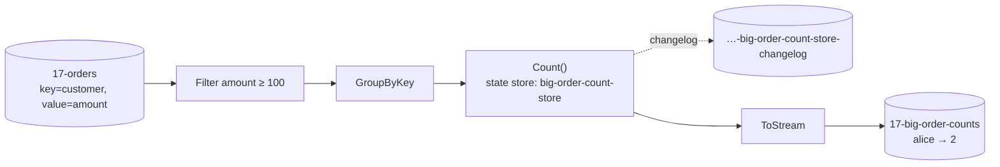

# 17 · Stream processing (Streamiz = Kafka Streams for .NET)

**Definition:** **Stream processing** continuously transforms topics into new topics — filter, map, join, aggregate — with local **state stores** backed by Kafka changelog topics.

**Why it matters:** "Count big orders per customer, live" without a database or a batch job. Kafka Streams is Java-only; **Streamiz.Kafka.Net** brings the same model to C#.

## Example

<!-- STORY -->

## Diagram



| Concept | Meaning |
|---|---|
| `KStream` | Every record is an event ("alice ordered 150") |
| `KTable` | Latest value per key ("alice has 2 big orders") |
| State store | Local key-value store (in-memory or RocksDB) per task |
| Changelog topic | Compacted topic that backs the store; used to restore after restart |
| Task | One input partition = one task = unit of parallelism |

## Code

[examples/17-stream-processing/Program.cs](../examples/17-stream-processing/Program.cs)

```csharp
var builder = new StreamBuilder();

builder.Stream<string, string>(input)
    .Filter((customer, amount, _) => decimal.Parse(amount) >= 100)
    .GroupByKey()
    .Count(InMemory.As<string, long>("big-order-count-store"))
    .ToStream()
    .MapValues((count, _) => count.ToString())
    .To(output);

var stream = new KafkaStream(builder.Build(), config);

await stream.StartAsync();
```

<!-- OUTPUT -->

## ✅ Correct vs ❌ wrong usage

| | Usage | Reason |
|---|---|---|
| ✅ | Key the input by what you group on | Avoids a repartition topic |
| ✅ | Same `ApplicationId` across instances to scale out | They share tasks like a consumer group |
| ❌ | Calling a database inside `MapValues` per record | Slow, not replayable; join with a KTable instead |
| ❌ | Changing `ApplicationId` on every deploy in production | State is rebuilt from scratch and output repeats |

## Pitfalls

1. Aggregations emit an **update per input** (alice → 1, then alice → 2); downstream must treat output as upserts.
2. `GroupBy` on a new key creates an internal repartition topic (extra I/O).
3. Streamiz and Kafka Streams (Java) use murmur2 partitioning — align .NET producers ([07](07-keys-ordering.md)).
4. Exactly-once in Streamiz: `Guarantee = ProcessingGuarantee.EXACTLY_ONCE`.

**Next:** [18 · Kafka Connect](18-kafka-connect.md)
