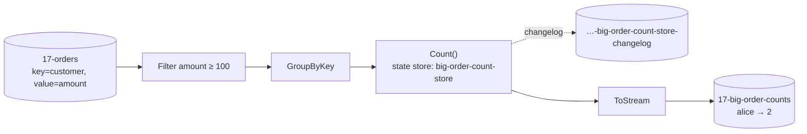

# 17 · Stream processing (Streamiz = Kafka Streams for .NET)

**Definition:** **Stream processing** continuously transforms topics into new topics — filter, map, join, aggregate — with local **state stores** backed by Kafka changelog topics.

**Why it matters:** "Count big orders per customer, live" without a database or a batch job. Kafka Streams is Java-only; **Streamiz.Kafka.Net** brings the same model to C#.

## Example

```
Initial data:
  topic 17-orders      : alice 150 · bob 30 · alice 20 · bob 300 · alice 500 · carol 99
  rule                 : big order = amount >= 100

Commands:
  Filter >= 100        : alice 150, bob 300, alice 500 pass (3 of 6)
  GroupByKey + Count   : state store big-order-count-store
  To 17-big-order-counts

Result:
  alice                : 1 → 2 (two updates emitted)
  bob                  : 1
  carol                : nothing (99 < 100)
```

## Diagram



| Concept | Meaning |
|---|---|
| `KStream` | Every record is an event ("alice ordered 150") |
| `KTable` | Latest value per key ("alice has 2 big orders") |
| State store | Local key-value store (in-memory or RocksDB) per task |
| Changelog topic | Compacted topic that backs the store; used to restore after restart |
| Task | One input partition = one task = unit of parallelism |

## Code

[examples/17-stream-processing/Program.cs](../examples/17-stream-processing/Program.cs)

```csharp
var builder = new StreamBuilder();

builder.Stream<string, string>(input)
    .Filter((customer, amount, _) => decimal.Parse(amount) >= 100)
    .GroupByKey()
    .Count(InMemory.As<string, long>("big-order-count-store"))
    .ToStream()
    .MapValues((count, _) => count.ToString())
    .To(output);

var stream = new KafkaStream(builder.Build(), config);   // config.Logger = warnings only

await stream.StartAsync();
```

Output (topology description, then the run):

```text
Topologies:
   Sub-topology: 0
    Source: KSTREAM-SOURCE-0000000000 (topics: [17-orders])
      --> KSTREAM-FILTER-0000000001
    Processor: KSTREAM-FILTER-0000000001 (stores: [])
      --> KSTREAM-AGGREGATE-0000000002
      <-- KSTREAM-SOURCE-0000000000
    Processor: KSTREAM-AGGREGATE-0000000002 (stores: [big-order-count-store])
      --> KTABLE-TOSTREAM-0000000003
      <-- KSTREAM-FILTER-0000000001
    Processor: KTABLE-TOSTREAM-0000000003 (stores: [])
      --> KSTREAM-MAPVALUES-0000000004
      <-- KSTREAM-AGGREGATE-0000000002
    Processor: KSTREAM-MAPVALUES-0000000004 (stores: [])
      --> KSTREAM-SINK-0000000005
      <-- KTABLE-TOSTREAM-0000000003
    Sink: KSTREAM-SINK-0000000005 (topic: 17-big-order-counts)
      <-- KSTREAM-MAPVALUES-0000000004

order in : alice 150
order in : bob 30
order in : alice 20
order in : bob 300
order in : alice 500
order in : carol 99
count out: alice -> 1 big order(s)
count out: bob -> 1 big order(s)
count out: alice -> 2 big order(s)
```

## ✅ Correct vs ❌ wrong usage

| | Usage | Reason |
|---|---|---|
| ✅ | Key the input by what you group on | Avoids a repartition topic |
| ✅ | Same `ApplicationId` across instances to scale out | They share tasks like a consumer group |
| ❌ | Calling a database inside `MapValues` per record | Slow, not replayable; join with a KTable instead |
| ❌ | Changing `ApplicationId` on every deploy in production | State is rebuilt from scratch and output repeats |

## Pitfalls

1. Aggregations emit an **update per input** (alice → 1, then alice → 2); downstream must treat output as upserts.
2. `GroupBy` on a new key creates an internal repartition topic (extra I/O).
3. Streamiz and Kafka Streams (Java) use murmur2 partitioning — align .NET producers ([07](07-keys-ordering.md)).
4. Exactly-once in Streamiz: `Guarantee = ProcessingGuarantee.EXACTLY_ONCE`.

Windows and joins: see [29](29-streams-windows-joins.md).

**Next:** [18 · Kafka Connect](18-kafka-connect.md)
