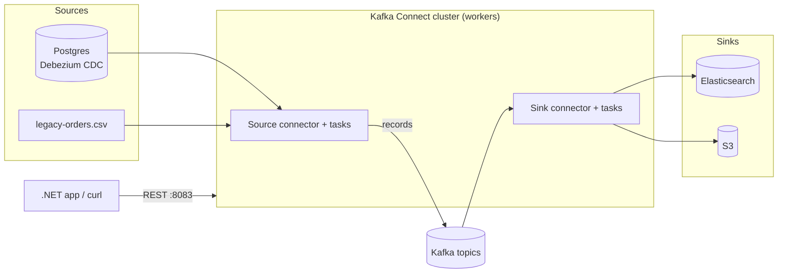

# 18 · Kafka Connect

**Definition:** **Kafka Connect** is a separate runtime that moves data between Kafka and other systems using configurable **connectors** (source → Kafka, Kafka → sink), managed through a REST API.

**Why it matters:** Copying a database, S3 bucket or file into Kafka is a solved problem — configure a connector instead of writing and operating a custom producer.

## Example

```
Initial data:
  file                 : connect/data/legacy-orders.csv (3 lines)
  connector            : FileStreamSourceConnector → topic 18-legacy-orders

Commands:
  GET /connector-plugins : 5 plugins (FileStream source/sink, MirrorMaker ×3)
  POST /connectors     : 201 Created
  GET …/status         : connector RUNNING, task0 RUNNING
  consume topic        : 1001,alice,120.50 · 1002,bob,35.00 · 1003,carol,980.00

Result:
  C# producer code     : 0 lines (C# only called the REST API)
  events               : 3, one per CSV line
```

## Diagram



| REST call | Purpose |
|---|---|
| `GET /connector-plugins` | Installed connector classes |
| `POST /connectors` | Create a connector from JSON config |
| `GET /connectors/{name}/status` | RUNNING / FAILED + stack trace |
| `PUT /connectors/{name}/pause` | Pause |
| `DELETE /connectors/{name}` | Remove |

## Code

[examples/18-kafka-connect/Program.cs](../examples/18-kafka-connect/Program.cs) — needs `docker compose --profile connect up -d`.

```csharp
var body = new
{
    name = connector,
    config = new Dictionary<string, string>
    {
        ["connector.class"] = "org.apache.kafka.connect.file.FileStreamSourceConnector",
        ["tasks.max"] = "1",
        ["file"] = "/connect/data/legacy-orders.csv",
        ["topic"] = topic
    }
};

var created = await http.PostAsJsonAsync("/connectors", body);
```

Output:

```text
plugins: FileStreamSinkConnector, FileStreamSourceConnector, MirrorCheckpointConnector, MirrorHeartbeatConnector, MirrorSourceConnector
POST /connectors -> 201 Created
connector state=RUNNING task0=RUNNING
event p0@0: 1001,alice,120.50
event p0@1: 1002,bob,35.00
event p0@2: 1003,carol,980.00
```

## ✅ Correct vs ❌ wrong usage

| | Usage | Reason |
|---|---|---|
| ✅ | Debezium for DB change data capture | Reads the DB log: no polling, no dual writes |
| ✅ | Distributed mode with 2+ workers | Tasks fail over between workers |
| ✅ | Single Message Transforms (SMTs) for light changes | Rename/route fields without code |
| ❌ | FileStream connectors in production | Demo only: no file rotation, no exactly-once |
| ❌ | Heavy business logic in SMTs | Use stream processing ([17](17-stream-processing.md)) |

## Pitfalls

1. Connect stores configs/offsets/status in Kafka topics — give them RF=3.
2. A connector `RUNNING` with a task `FAILED` still looks "up"; monitor task status.
3. Converters must match: `StringConverter` vs `JsonConverter` (`schemas.enable`) vs Avro.
4. Secrets in connector configs are visible via REST — use config providers.

**Next:** [19 · Outbox pattern](19-outbox-pattern.md)
