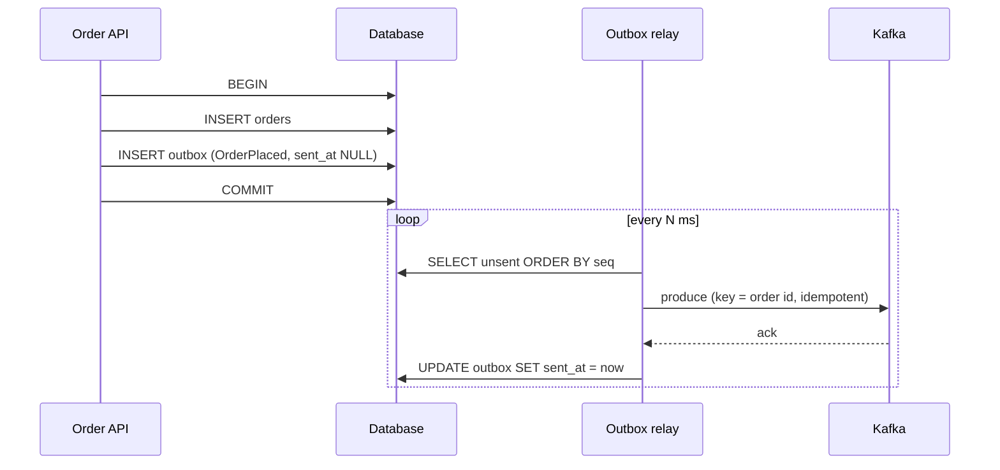
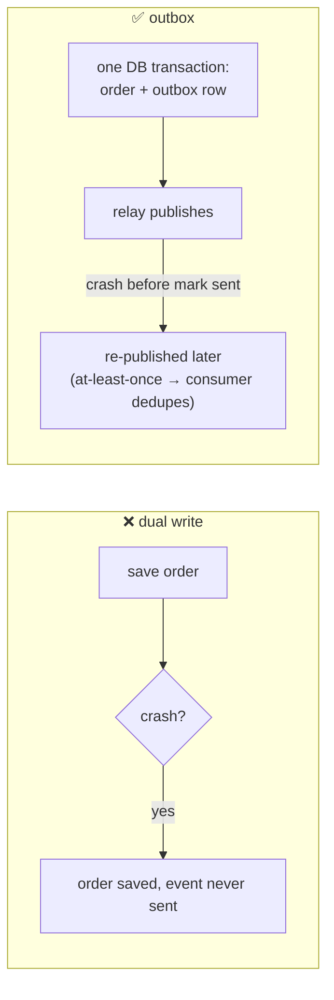
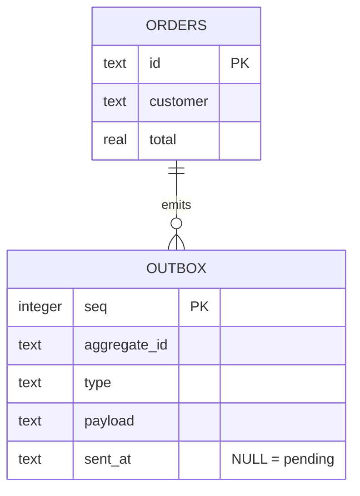

# 19 · Transactional outbox pattern

**Definition:** The **outbox pattern** writes the business row **and** the event row into the same database transaction; a separate **relay** later publishes outbox rows to Kafka.

**Why it matters:** "Save order, then produce event" is a *dual write*: if the app crashes between them, the DB and Kafka disagree forever. The outbox makes both happen or neither.

## Example

```
Initial data:
  tables               : orders, outbox (SQLite)
  requests             : ord-1 (120.5), ord-2 (35.0), ord-3 (-1, invalid)

Commands:
  PlaceOrder ord-1, 2  : 1 transaction each: order row + outbox row
  PlaceOrder ord-3     : rollback → no order, no outbox row
  relay                : outbox seq 1 → p0@0, seq 2 → p0@1, mark sent_at

Result:
  orders / outbox      : 2 / 2
  pending after relay  : 0
  events without order : impossible (same transaction)
```

## Diagram







## Code

[examples/19-outbox-pattern/Program.cs](../examples/19-outbox-pattern/Program.cs) (SQLite to stay dependency-free; same SQL works on Postgres/SQL Server)

```csharp
using var tx = db.BeginTransaction();

Execute("INSERT INTO orders VALUES ($p0, $p1, $p2)", id, customer, total);

Execute("INSERT INTO outbox (aggregate_id, type, payload) VALUES ($p0, 'OrderPlaced', $p1)", id, json);

tx.Commit();

// relay
var result = await producer.ProduceAsync(topic, new Message<string, string> { Key = row.Key, Value = row.Payload, Headers = headers });

Execute("UPDATE outbox SET sent_at = $p0 WHERE seq = $p1", DateTime.UtcNow.ToString("O"), row.Seq);
```

Output:

```text
ord-1 saved (order + outbox row in one transaction)
ord-2 saved (order + outbox row in one transaction)
ord-3 rejected: total must be positive -> no order row, no outbox row
[after PlaceOrder] orders=2 outbox=2 pending=2
relay: outbox seq 1 -> 19-order-events p0@0
relay: outbox seq 2 -> 19-order-events p0@1
[after relay] orders=2 outbox=2 pending=0
```

## ✅ Correct vs ❌ wrong usage

| | Usage | Reason |
|---|---|---|
| ✅ | Relay with Debezium (CDC on the outbox table) | No polling, preserves commit order |
| ✅ | Event id header (`outbox-seq`) + consumer dedupe | Relay is at-least-once |
| ✅ | Key = aggregate id | Events of one order stay ordered |
| ❌ | `SaveChanges()` then `ProduceAsync()` in the request | Dual write; crash in between = lost event |
| ❌ | Produce inside the DB transaction before commit | Rollback after produce = phantom event |

## Pitfalls

1. Several relay instances must not publish the same rows concurrently (`SELECT … FOR UPDATE SKIP LOCKED` or a single leader).
2. Clean old sent rows, or the outbox table grows forever.
3. Publishing order across aggregates is only as good as `ORDER BY seq`.
4. Relay lag = event latency; monitor count of pending rows.

**Next:** [20 · Performance tuning](20-performance-tuning.md)
