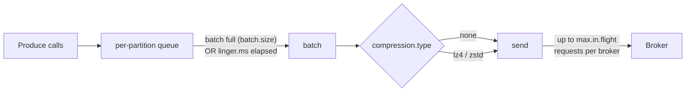

# 20 · Performance tuning

**Definition:** Kafka **throughput** comes from sending big, compressed batches in parallel; tuning trades a few milliseconds of latency (`linger.ms`) for much higher throughput.

**Why it matters:** The same code can move 10× more data with three config lines — or waste the cluster with tiny requests.

## Example

200,000 records of ~112 B JSON, `acks=all`, 6 partitions:

| `linger.ms` | Compression | msg/s | Time | On disk |
|---|---|---|---|---|
| 0 | none | 7,459 | 26.81 s | 26,372 KiB |
| 5 | none | 119,267 | 1.68 s | 25,952 KiB |
| 20 | none | **266,343** | 0.75 s | 25,952 KiB |
| 20 | lz4 | 202,332 | 0.99 s | 3,236 KiB |
| 20 | zstd | 187,929 | 1.06 s | **1,132 KiB** |

- linger 0 → 20: 266,343 / 7,459 = **35.7×** throughput (bigger batches, fewer requests).
- zstd vs none: 25,952 / 1,132 = **22.9×** smaller on disk.

## Diagram



| Knob | Throughput ↑ | Latency | Notes |
|---|---|---|---|
| `linger.ms` (0 → 5–50) | bigger batches | + up to linger | librdkafka default 5 |
| `batch.size` | bigger batches | — | per partition |
| `compression.type` | fewer bytes on wire/disk | small CPU | `lz4` fast, `zstd` smallest |
| more partitions | more parallel leaders/consumers | — | see [03](03-topics-partitions-offsets.md) |
| `acks` | `1` faster than `all` | — | durability trade-off ([08](08-delivery-semantics.md)) |
| consumer `fetch.min.bytes` / `fetch.wait.max.ms` | fewer fetch requests | + wait | |

## Code

[examples/20-performance-tuning/Program.cs](../examples/20-performance-tuning/Program.cs)

```csharp
var config = new ProducerConfig
{
    BootstrapServers = bootstrap,
    Acks = Acks.All,
    LingerMs = lingerMs,
    BatchSize = 256 * 1024,
    CompressionType = compression,
    QueueBufferingMaxMessages = 500_000
};

for (var i = 0; i < count; i++)
{
    producer.Produce(topic, new Message<string, string> { Key = $"order-{i % 1000}", Value = value });
}

producer.Flush(TimeSpan.FromMinutes(2));
```

Real run (laptop, 3 brokers in Docker, 4 CPUs) and the disk usage per topic afterwards:

Output:

```text
payload size ~112 bytes, 200,000 records, acks=all

setup                         |   msgs/s |  MB/s | elapsed
------------------------------+----------+-------+--------
linger=0   no compression     |    7,459 |   0.8 | 26.81s
linger=5   no compression     |  119,267 |  12.9 |  1.68s
linger=20  no compression     |  266,343 |  28.8 |  0.75s
linger=20  lz4                |  202,332 |  21.9 |  0.99s
linger=20  zstd               |  187,929 |  20.3 |  1.06s
```

```text
$ docker exec kafka-1 du -ck /tmp/kafka-logs/20-perf-<setup>-*   (all 6 partitions, one replica)
20-perf-none-0      26372 KiB
20-perf-none-5      25952 KiB
20-perf-none-20     25952 KiB
20-perf-lz4-20       3236 KiB
20-perf-zstd-20      1132 KiB
```

Reading the numbers:

| Finding | Value |
|---|---|
| `linger.ms` 0 → 20 | 7,459 → 266,343 msg/s (35.7×) |
| Compression on disk | none 25,952 KiB → lz4 3,236 KiB (8.0× smaller) → zstd 1,132 KiB (22.9× smaller) |
| Compression throughput | lower here (CPU-bound laptop shared with 3 brokers); on a real network the 8–23× fewer bytes usually wins |

## ✅ Correct vs ❌ wrong usage

| | Usage | Reason |
|---|---|---|
| ✅ | `Produce` + callback, not `await ProduceAsync` in a loop | Thousands of messages in flight instead of one |
| ✅ | `lz4`/`zstd` for JSON | Text compresses 3–10× |
| ✅ | Measure with your real payloads | Results depend on size and compressibility |
| ❌ | `linger.ms=0` "for low latency" on a busy producer | Many tiny requests: lower throughput **and** often higher p99 |
| ❌ | `await ProduceAsync` sequentially for bulk loads | One round trip per message (see [08](08-delivery-semantics.md): ~ms each) |

## Pitfalls

1. Benchmarks on one laptop with 3 Docker brokers share CPU/disk — numbers show **relative** gains only.
2. Compression is done by the producer; the broker keeps it (unless topic `compression.type` differs → recompression).
3. Consumer side: slow processing, not fetching, is usually the bottleneck — parallelize by partitions.
4. `queue.buffering.max.messages` full → `Produce` throws `Local_QueueFull`; back off or raise it.

**Next:** [21 · Security](21-security.md)
