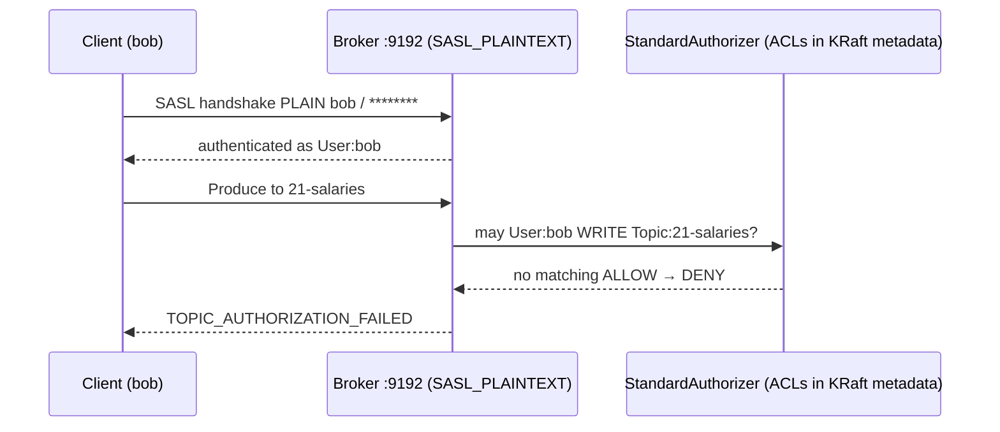

# 21 · Security: SASL + ACLs

**Definition:** **Authentication** (SASL: PLAIN, SCRAM, OAUTHBEARER, or mTLS) proves *who* a client is; **authorization** (ACLs) decides *what* that principal may do; **TLS** encrypts the wire.

**Why it matters:** A default Kafka listener lets anyone on the network read every topic and delete them. Production clusters need all three.

## Example

```
Initial data:
  broker               : localhost:9192, SASL_PLAINTEXT + PLAIN, StandardAuthorizer
  users                : admin (super user), alice, bob
  ACL                  : User:alice Allow Write on Topic:21-salaries

Commands:
  alice / alice-secret : write OK
  bob / bob-secret     : TopicAuthorizationFailed (authenticated, not authorized)
  bob / wrong-password : Local_Authentication (not authenticated)

Result:
  allowed writers      : 1 of 3 attempts
  default              : deny (allow.everyone.if.no.acl.found=false)
```

## Diagram



| Layer | Options | Production choice |
|---|---|---|
| Encryption | `SSL` / `SASL_SSL` | always TLS (`SASL_SSL`) |
| Authentication | PLAIN, SCRAM-SHA-512, OAUTHBEARER, mTLS | SCRAM or OAuth (PLAIN only over TLS) |
| Authorization | `StandardAuthorizer` ACLs | deny by default, least privilege |

## Code

[examples/21-security/Program.cs](../examples/21-security/Program.cs) — needs `docker compose --profile security up -d`.

```csharp
ClientConfig As(string user, string password) => new()
{
    BootstrapServers = bootstrap,
    SecurityProtocol = SecurityProtocol.SaslPlaintext,   // SaslSsl in production
    SaslMechanism = SaslMechanism.Plain,
    SaslUsername = user,
    SaslPassword = password
};

var allowAliceWrite = new AclBinding
{
    Pattern = new ResourcePattern { Type = ResourceType.Topic, Name = topic, ResourcePatternType = ResourcePatternType.Literal },
    Entry = new AccessControlEntry { Principal = "User:alice", Host = "*", Operation = AclOperation.Write, PermissionType = AclPermissionType.Allow }
};

await admin.CreateAclsAsync([allowAliceWrite]);
```

Output:

```text
ACL: User:alice Allow Write on Topic:21-salaries

alice (alice-secret  ) write -> OK offset 1
bob   (bob-secret    ) write -> DENIED TopicAuthorizationFailed
bob   (wrong-password) write -> DENIED Local_Authentication
```

## ✅ Correct vs ❌ wrong usage

| | Usage | Reason |
|---|---|---|
| ✅ | One principal per service, ACLs per topic/group | Blast radius of a leaked secret stays small |
| ✅ | Prefixed ACLs (`orders.*`) for a team's topics | Fewer rules |
| ✅ | Passwords from a secret store / env vars | Not in Git |
| ❌ | `SASL_PLAINTEXT` + PLAIN over a real network | Password readable on the wire |
| ❌ | `allow.everyone.if.no.acl.found=true` | Any new topic is open to everyone |

## Pitfalls

1. Consumers need **READ on the topic and READ on the group**.
2. Transactional/idempotent producers need extra ACLs (`WRITE` on `TransactionalId`, `IDEMPOTENT_WRITE` on cluster in older versions).
3. Super users bypass ACLs — keep the list minimal.
4. The demo passwords in [docker-compose.yml](../docker-compose.yml) are public; never reuse them.

**Next:** [22 · Monitoring](22-monitoring.md)
