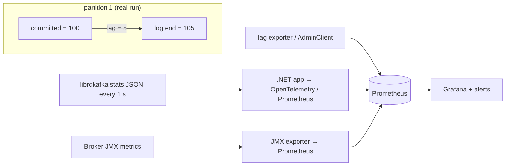

# 22 · Monitoring

**Definition:** **Consumer lag** = log end offset − committed offset, per partition: how many records a group still has to process.

**Why it matters:** Lag is the single best signal that consumers are slow, stuck, or dead. Client statistics (RTT, queue sizes, errors) explain *why*.

## Example

```
Initial data:
  topic                : 22-emails, 3 partitions, 300 records
  group                : 22-email-sender processes 100, then stops

Commands:
  producer stats       : txmsgs=300, queued=0, broker rtt avg 12.4–14.4 ms
  ListConsumerGroupOffsets : p0 0 · p1 100 · p2 0
  QueryWatermarkOffsets    : p0 103 · p1 105 · p2 92

Result:
  lag                  : (103 − 0) + (105 − 100) + (92 − 0) = 200
  check                : 300 produced − 100 processed = 200
```

## Diagram



| Metric | Source | Alert when |
|---|---|---|
| Consumer lag (records & time) | AdminClient / lag exporter | growing for > 5 min |
| Under-replicated partitions | broker JMX | > 0 |
| Offline partitions | controller JMX | > 0 |
| Producer request latency (`rtt`) | client stats | p99 rising |
| Request errors / retries | client stats | > 0 sustained |
| Disk usage per broker | OS | > 75 % |

## Code

[examples/22-monitoring/Program.cs](../examples/22-monitoring/Program.cs)

```csharp
// lag = log end offset (high watermark) - committed offset, per partition
// ask for every partition: partitions the group never committed count from offset 0
var partitions = Enumerable.Range(0, 3).Select(p => new TopicPartition(topic, p)).ToList();

var committed = await admin.ListConsumerGroupOffsetsAsync([new ConsumerGroupTopicPartitions(group, partitions)]);

foreach (var tpo in committed[0].Partitions)
{
    var end = probe.QueryWatermarkOffsets(tpo.TopicPartition, TimeSpan.FromSeconds(5)).High.Value;

    Console.WriteLine($"{tpo.Partition.Value} | {end} | {tpo.Offset.Value} | {end - tpo.Offset.Value}");
}

// client statistics: JSON every StatisticsIntervalMs
new ProducerBuilder<string, string>(new ProducerConfig { StatisticsIntervalMs = 1000 }).SetStatisticsHandler((_, json) => lastStats = json)
```

Output:

```text
producer stats: txmsgs=300 txbytes=7280 queued=0
  broker 3: requests=4 rtt avg=12.4 ms p99=25.1 ms
  broker 2: requests=2 rtt avg=14.4 ms p99=23.7 ms
  broker 1: requests=2 rtt avg=12.9 ms p99=23.0 ms

partition | end offset | committed | lag
        0 |        103 |         0 | 103
        1 |        105 |       100 | 5
        2 |         92 |         0 | 92
total lag for group 22-email-sender = 200
```

## ✅ Correct vs ❌ wrong usage

| | Usage | Reason |
|---|---|---|
| ✅ | Alert on lag **trend** and lag in seconds | 10k lag can be fine on a fast topic |
| ✅ | Export `StatisticsHandler` JSON to OpenTelemetry/Prometheus | Per-broker RTT, queue depth, errors |
| ✅ | Log `SetErrorHandler` events | Connection/auth errors are otherwise silent |
| ❌ | Only check "is the consumer process running?" | A stuck loop is running but not progressing |
| ❌ | Statistics every 100 ms in production | JSON is large; 5–60 s is enough |

## Pitfalls

1. A partition with no committed offset is missing from `ListConsumerGroupOffsets(group, null)` — ask for all partitions explicitly or you under-report lag (first version of this example showed 3 instead of 200).
2. Lag on compacted/transactional topics can never reach exactly 0 due to markers/gaps.
3. Broker metrics are JMX (Java); you need an exporter.
4. Rebalances make lag spike briefly — alert with a time window.

**Next:** [23 · Testing](23-testing.md)
