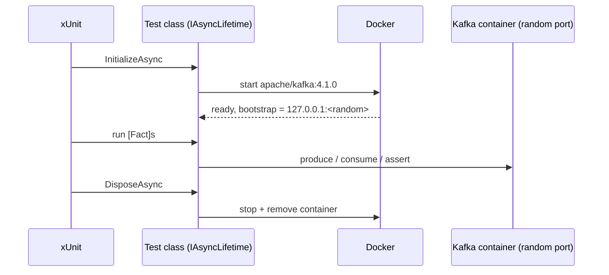

# 23 · Testing with Testcontainers

**Definition:** **Testcontainers** starts a real, throw-away Kafka broker in Docker from inside a test, so integration tests run against real Kafka instead of mocks.

**Why it matters:** Mocks of `IProducer` prove nothing about serialization, partitioning, or offsets. A real broker per test class catches those bugs in CI.

## Example

```
Initial data:
  image                : apache/kafka:4.1.0 (started by Testcontainers)
  tests                : 2 [Fact]s in OrderEventsTests

Commands:
  dotnet test          : container start → tests run → container removed
  test 1               : produce ord-1 → consume → key and value equal
  test 2               : 10 × key acc-42 → partitions seen = 1

Result:
  passed               : 2 of 2
  total time           : 21.6 s (mostly container start)
```

## Diagram



| Test level | Tool | Kafka |
|---|---|---|
| Unit | xUnit + plain functions | none — test handlers with `ConsumeResult` objects you build |
| Integration | Testcontainers.Kafka | real broker per class |
| End-to-end | docker compose / staging | real cluster |

## Code

[examples/23-testing/OrderEventsTests.cs](../examples/23-testing/OrderEventsTests.cs)

```csharp
public sealed class OrderEventsTests : IAsyncLifetime
{
    private readonly KafkaContainer _kafka = new KafkaBuilder("apache/kafka:4.1.0").Build();

    public async Task InitializeAsync() => await _kafka.StartAsync();

    public async Task DisposeAsync() => await _kafka.DisposeAsync();

    [Fact]
    public async Task Produced_event_is_consumed_with_same_key_and_value()
    {
        var bootstrap = _kafka.GetBootstrapAddress();

        // produce, consume, Assert.Equal(...)
    }
}
```

Run: `cd examples/23-testing && dotnet test`

Output:

```text
  Passed KafkaTesting.OrderEventsTests.Same_key_always_goes_to_same_partition [679 ms]
  Passed KafkaTesting.OrderEventsTests.Produced_event_is_consumed_with_same_key_and_value [3 s]
Total tests: 2
     Passed: 2
 Total time: 21.6450 Seconds
```

## ✅ Correct vs ❌ wrong usage

| | Usage | Reason |
|---|---|---|
| ✅ | Keep message handlers as pure functions; unit-test them without Kafka | Fast tests for business logic |
| ✅ | One container per test class (or collection fixture) | Startup cost paid once |
| ✅ | Unique topic / group names per test | Tests don't see each other's data |
| ❌ | `Thread.Sleep(5000)` then assert | Flaky; consume with a timeout and assert on the result |
| ❌ | Point tests at a shared dev cluster | Tests interfere; state leaks between runs |

## Pitfalls

1. The first run pulls the image — pre-pull in CI.
2. Container gets a **random host port**; always use `GetBootstrapAddress()`.
3. `auto.offset.reset=earliest` in tests, or you miss records produced before subscribing.
4. Single-broker containers need RF=1 topics.

**Next:** [24 · Production checklist](24-production-checklist.md)
