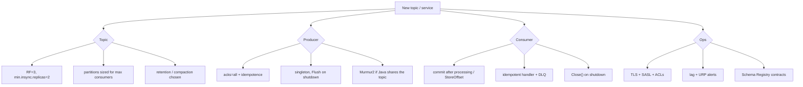

# 24 · Production checklist

**Definition:** A **production checklist** is the set of broker, topic, and client settings that turn a working demo into a cluster that does not lose data or fall over.

**Why it matters:** Most Kafka incidents come from defaults nobody revisited: RF=1 topics, `acks=1`, no lag alerts, producers created per request.

## Example

Lint rules run against all 23 user topics; 22 pass. The one that fails:

| Rule | Safe value | `24-risky-topic` | Risk |
|---|---|---|---|
| replication factor | ≥ 3 | 1 | ❌ one disk failure = data loss |
| `min.insync.replicas` | 2, and ≤ RF | 2 (> RF 1) | ❌ `acks=all` writes always fail |
| `unclean.leader.election.enable` | false | true | ❌ data loss on failover |

## Diagram



## Checklist

| Area | Setting / practice | Why | Doc |
|---|---|---|---|
| Topic | RF=3, `min.insync.replicas=2` | Survive 1 broker | [12](12-replication-isr.md) |
| Topic | `unclean.leader.election.enable=false` | No silent loss | [12](12-replication-isr.md) |
| Topic | Explicit partitions; disable `auto.create.topics.enable` | Predictable layout | [03](03-topics-partitions-offsets.md) |
| Producer | `acks=all`, `enable.idempotence=true` | No loss, no retry dupes | [08](08-delivery-semantics.md) |
| Producer | `linger.ms` 5–20, `compression.type=lz4/zstd` | Throughput | [20](20-performance-tuning.md) |
| Producer | One instance per app, `Flush` on stop | Performance, no lost tail | [04](04-producer.md) |
| Consumer | Manual store/commit after processing | At-least-once | [09](09-offset-commits.md) |
| Consumer | Idempotent processing + DLQ | Duplicates & poison pills | [11](11-errors-retries-dlq.md) |
| Consumer | cooperative-sticky or `group.protocol=consumer` | Smooth rebalances | [06](06-consumer-groups.md) |
| Data | Schema Registry, backward compatibility | Safe evolution | [10](10-serialization-schema-registry.md) |
| Data | Outbox for DB + event | No dual writes | [19](19-outbox-pattern.md) |
| Security | `SASL_SSL`, ACLs, no `allow.everyone` | Least privilege | [21](21-security.md) |
| Ops | Alerts: lag, under-replicated, offline partitions, disk | Early warning | [22](22-monitoring.md) |
| Ops | 3 or 5 controllers, brokers across racks/AZs | Fault domains | [15](15-kraft-metadata.md) |
| Tests | Testcontainers integration tests | Real behavior in CI | [23](23-testing.md) |

## Code

[examples/24-production-checklist/Program.cs](../examples/24-production-checklist/Program.cs) — lints every topic in the cluster.

```csharp
if (rf < 3)
{
    issues.Add($"replication.factor={rf} (want >= 3)");
}

if (minIsr > rf)
{
    issues.Add($"min.insync.replicas={minIsr} > rf (acks=all writes always fail)");
}
else if (rf >= 3 && (minIsr < 2 || minIsr == rf))
{
    issues.Add($"min.insync.replicas={minIsr} (want 2 with RF=3)");
}

if (unclean)
{
    issues.Add("unclean.leader.election.enable=true (data loss on failover)");
}
```

Output:

```text
OK   01-hello                   partitions=3  rf=3 minIsr=2 
OK   03-orders                  partitions=3  rf=3 minIsr=2 
OK   04-payments                partitions=3  rf=3 minIsr=2 
OK   05-shipments               partitions=3  rf=3 minIsr=2 
OK   06-clicks                  partitions=6  rf=3 minIsr=2 
OK   07-account-events          partitions=3  rf=3 minIsr=2 
OK   08-sensor-readings         partitions=3  rf=3 minIsr=2 
OK   09-invoices                partitions=1  rf=3 minIsr=2 
OK   11-orders                  partitions=1  rf=3 minIsr=2 
OK   11-orders.dlq              partitions=1  rf=3 minIsr=2 
OK   12-bank-transfers          partitions=3  rf=3 minIsr=2 
OK   13-customer-addresses      partitions=1  rf=3 minIsr=2 
OK   14-clickstream             partitions=1  rf=3 minIsr=2 
OK   16-ledger                  partitions=1  rf=3 minIsr=2 
OK   16-transfers               partitions=1  rf=3 minIsr=2 
OK   19-order-events            partitions=3  rf=3 minIsr=2 
OK   20-perf-lz4-20             partitions=6  rf=3 minIsr=2 
OK   20-perf-none-0             partitions=6  rf=3 minIsr=2 
OK   20-perf-none-20            partitions=6  rf=3 minIsr=2 
OK   20-perf-none-5             partitions=6  rf=3 minIsr=2 
OK   20-perf-zstd-20            partitions=6  rf=3 minIsr=2 
OK   22-emails                  partitions=3  rf=3 minIsr=2 
WARN 24-risky-topic             partitions=1  rf=1 minIsr=2 replication.factor=1 (want >= 3); min.insync.replicas=2 > rf (acks=all writes always fail); unclean.leader.election.enable=true (data loss on failover)

23 topics checked, 3 problem(s) found
```

## ✅ Correct vs ❌ wrong usage

| | Usage | Reason |
|---|---|---|
| ✅ | Run a config linter like this in CI against staging | Drift is caught before incidents |
| ✅ | Recommended .NET producer config below | Safe by default |
| ❌ | Copy dev compose settings (combined mode, PLAINTEXT) to prod | Dev shortcuts are unsafe |

```csharp
var producerConfig = new ProducerConfig
{
    BootstrapServers = "...",
    Acks = Acks.All,
    EnableIdempotence = true,
    LingerMs = 10,
    CompressionType = CompressionType.Lz4,
    Partitioner = Partitioner.Murmur2Random,
    SecurityProtocol = SecurityProtocol.SaslSsl
};

var consumerConfig = new ConsumerConfig
{
    BootstrapServers = "...",
    GroupId = "billing-service",
    EnableAutoCommit = true,
    EnableAutoOffsetStore = false,          // StoreOffset(record) after processing
    AutoOffsetReset = AutoOffsetReset.Earliest,
    GroupProtocol = GroupProtocol.Consumer, // Kafka 4.x
    SecurityProtocol = SecurityProtocol.SaslSsl
};
```

## Pitfalls

1. Capacity: plan disk = produce rate × retention × RF × 1.3 headroom.
2. Upgrade brokers one at a time, waiting for under-replicated partitions = 0 between nodes.
3. Never delete `__consumer_offsets` or `__transaction_state`.
4. Practice failure (stop a broker in staging) before it happens in production.

**Next:** [25 · Request lifecycle](25-request-lifecycle.md) (deep-dive track)
