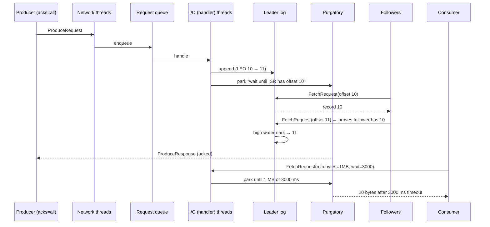
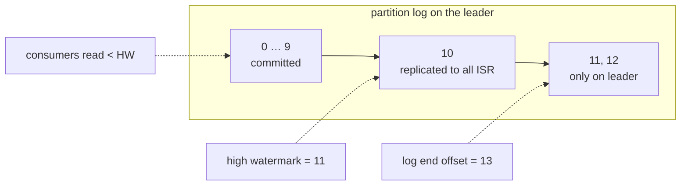

# 25 · Request lifecycle: produce, fetch, purgatory, high watermark

**Definition:** Every client call is a **request** that a broker queues, handles, and — if it cannot answer yet — parks in **purgatory** until a condition is met (enough replicas, enough bytes, or a timeout).

**Why it matters:** It explains real latencies: why `acks=all` waits for the slowest follower, why a consumer sometimes waits exactly `fetch.wait.max.ms`, and why consumers can't see records that aren't fully replicated yet.

## Example

```
Initial data:
  topic                : 25-latency, 1 partition, RF 3
  record               : one 20-byte value
  consumer             : fetch already waiting in the broker before the produce

Commands:
  fetch.min.bytes=1,  wait 500  : consumed 85 ms after send (= right after the ack)
  fetch.min.bytes=1MB, wait 500 : consumed 508 ms after send
  fetch.min.bytes=1MB, wait 3000: consumed 2042 ms after send
  read 12-bank-transfers p0     : offsets 0,1 leaderEpoch 0 · offset 2 leaderEpoch 1

Result:
  delay                : the fetch sits in purgatory until 1 MB arrives OR wait.max.ms expires
  leader epoch         : +1 each time leadership moved (doc 12 stopped and restarted brokers)
```

## Diagram





| Term | Meaning |
|---|---|
| **LEO** | Log end offset: next offset to append on one replica |
| **High watermark (HW)** | Smallest LEO among ISR; consumers only read below it |
| **Leader epoch** | Number that grows every time a partition gets a new leader; stored in each batch |
| **Purgatory** | Broker's waiting room for produce (acks=all) and fetch (min.bytes) requests |
| **Truncation** | A restarted replica asks `OffsetsForLeaderEpoch` and cuts records the new leader never had |

## Code

[examples/25-request-lifecycle/Program.cs](../examples/25-request-lifecycle/Program.cs)

```csharp
var config = new ConsumerConfig
{
    BootstrapServers = bootstrap,
    GroupId = "25-latency-reader",
    FetchMinBytes = fetchMinBytes,
    FetchWaitMaxMs = fetchWaitMaxMs
};

// start polling first, so a fetch request is already parked in the broker's purgatory
var received = Task.Run(() => consumer.Consume(TimeSpan.FromSeconds(10)));

await producer.ProduceAsync(topic, new Message<Null, string> { Value = "order-created-00001" });

// every record carries the leader epoch it was written in
Console.WriteLine($"offset {r.Offset.Value}: leaderEpoch={r.LeaderEpoch}");
```

Output:

```text
fetch.min.bytes | fetch.wait.max.ms | produce -> consume latency of ONE 20-byte record
              1 |               500 | ack   85 ms, consumed after    85 ms (ok)
      1,000,000 |               500 | ack   11 ms, consumed after   508 ms (ok)
      1,000,000 |              3000 | ack   15 ms, consumed after  2014 ms (ok)

leader epoch of each record in 12-bank-transfers partition 0 (run example 12 first):
  offset 0: leaderEpoch=0 value=100 EUR
  offset 1: leaderEpoch=0 value=100 EUR
  offset 2: leaderEpoch=1 value=100 EUR
```

## ✅ Correct vs ❌ wrong usage

| | Usage | Reason |
|---|---|---|
| ✅ | Raise `fetch.min.bytes` for analytics/batch consumers | Fewer, bigger fetches; less broker CPU |
| ✅ | Keep `fetch.min.bytes=1` for latency-sensitive consumers | Answer as soon as one record exists |
| ❌ | `fetch.min.bytes=1MB` on a low-traffic topic with `fetch.wait.max.ms=3000` | Every record waits ~3 s (see output) |
| ❌ | Reading followers' data directly to "go faster" | Data above HW can be truncated after a failover |

## Pitfalls

1. A slow follower that is still in the ISR delays **every** `acks=all` produce (up to `replica.lag.time.max.ms`).
2. Request queue saturation (`RequestQueueSize`, `RequestHandlerAvgIdlePercent` near 0) looks like "Kafka is slow" for all clients.
3. Leader epochs, not the HW alone, are what prevent divergent logs after unclean failovers (KIP-101).
4. Big batches (`max.request.size`) block I/O threads longer; tune together with `num.io.threads`.

**Next:** [26 · Group coordinator](26-group-coordinator.md)
