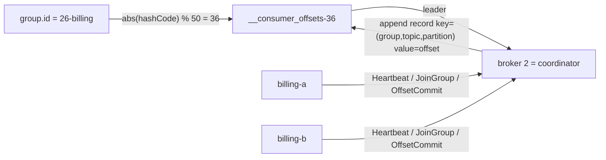
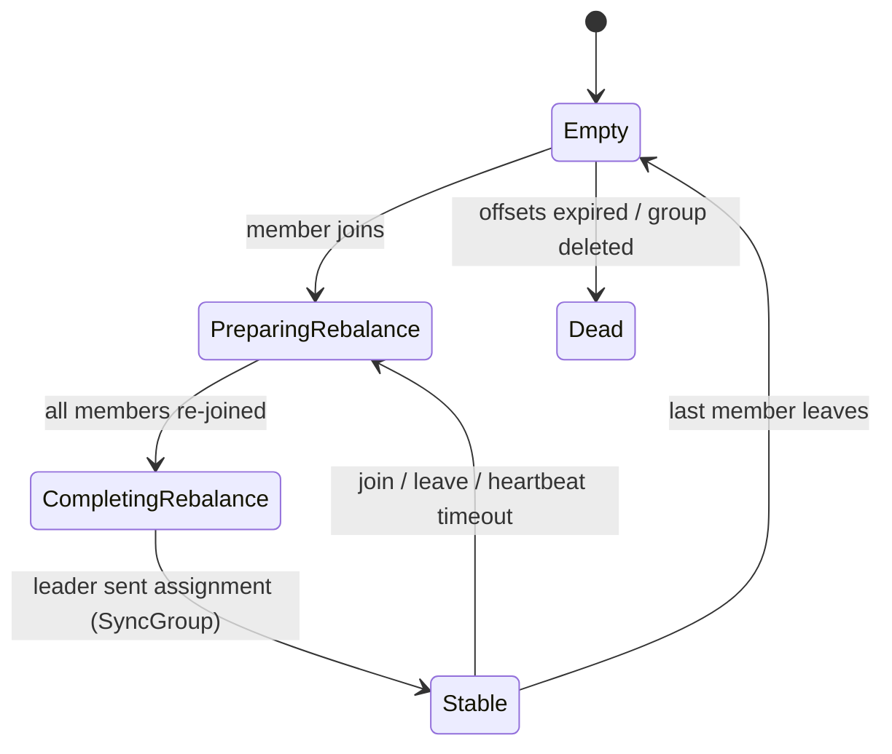

# 26 · Group coordinator & `__consumer_offsets`

**Definition:** The **group coordinator** is the broker that manages one consumer group (membership, rebalances, commits); it is the leader of the `__consumer_offsets` partition chosen by hashing the group id.

**Why it matters:** Commits, rebalances and lag all go through that one broker. Knowing which one lets you debug "group stuck in rebalancing" and "commit failed: not coordinator" errors.

## Example

Which broker manages group `26-billing`? Pure arithmetic:

```
1. h = javaHashCode("26-billing")        = 953190386
2. p = h % offsets.topic.num.partitions  = 953190386 % 50 = 36
3. coordinator = leader of __consumer_offsets-36 = broker 2
```

DescribeConsumerGroups confirms it: state Stable, assignor range, coordinator broker 2, members billing-a [0,1] and billing-b [2,3]. Every commit of `26-billing` is a record in `__consumer_offsets-36`.

## Diagram





`__consumer_offsets` is a **compacted** topic: key = (group, topic, partition), value = committed offset + metadata. The latest value per key wins.

## Code

[examples/26-group-coordinator/Program.cs](../examples/26-group-coordinator/Program.cs)

```csharp
// the coordinator is the leader of __consumer_offsets partition = abs(javaHashCode(groupId)) % 50
var offsetsPartition = (JavaHashCode(group) & 0x7fffffff) % 50;

var described = await admin.DescribeConsumerGroupsAsync([group]);

var g = described.ConsumerGroupDescriptions[0];

Console.WriteLine($"state={g.State} assignor={g.PartitionAssignor} coordinator=broker {g.Coordinator.Id}");
```

Output:

```text
group "26-billing": javaHashCode=953190386 -> __consumer_offsets partition 36 -> leader broker 2
DescribeConsumerGroups: state=Stable assignor=range coordinator=broker 2
  member billing-a  owns partitions [0,1]
  member billing-b  owns partitions [2,3]
coordinator == leader of __consumer_offsets-36? True
```

## ✅ Correct vs ❌ wrong usage

| | Usage | Reason |
|---|---|---|
| ✅ | Many small groups, spread naturally by hashing | Load spreads over the 50 offset partitions |
| ✅ | `kafka-consumer-groups.sh --describe --group X` to see coordinator, lag, members | First stop when debugging |
| ❌ | Changing `offsets.topic.num.partitions` after the cluster is created | Every group's coordinator would move — not supported |
| ❌ | Producing to `__consumer_offsets` yourself | Corrupts groups |

## Pitfalls

1. One hot coordinator broker (thousands of groups hashing there) slows commits for all of them.
2. `NOT_COORDINATOR` / `COORDINATOR_LOAD_IN_PROGRESS` after a broker restart are normal and retried (you saw them as `%4|GETPID` lines in earlier runs).
3. With KIP-848 (`group.protocol=consumer`) the coordinator also **computes** the assignment; the state machine above is the classic one.
4. Empty groups keep offsets for `offsets.retention.minutes` (7 days), then they are deleted.

**Next:** [27 · Share groups](27-share-groups.md)
