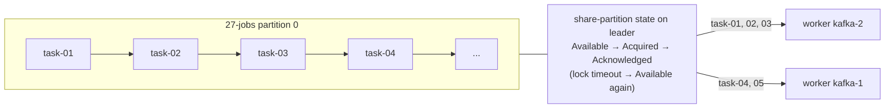
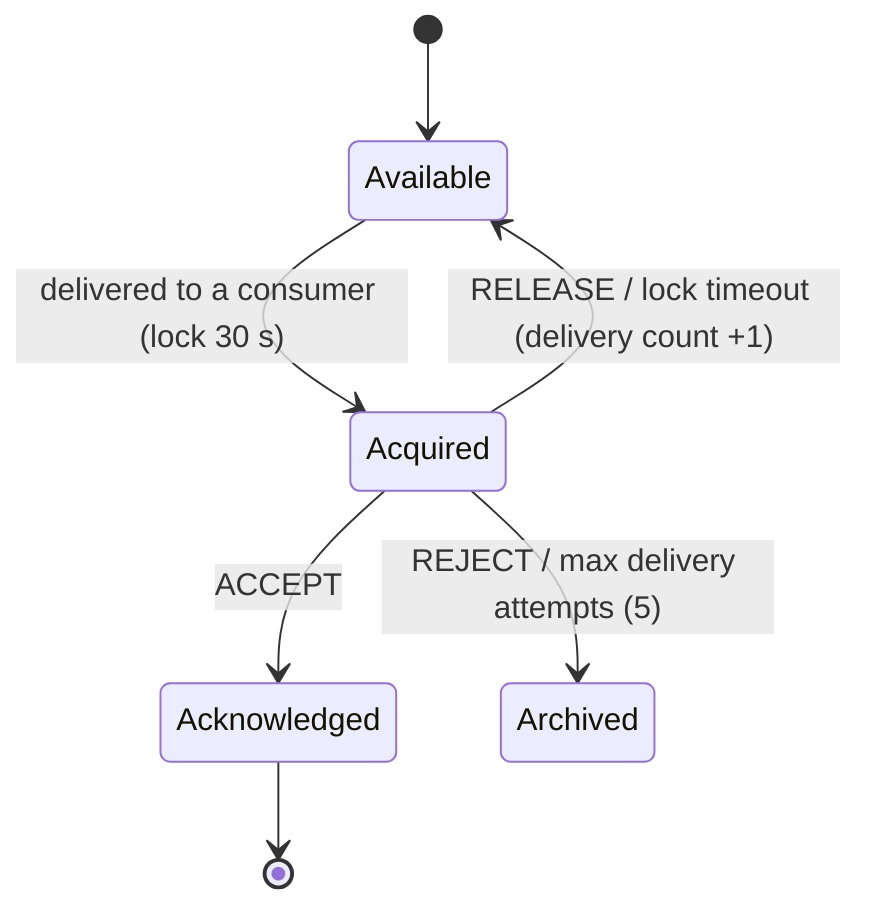

# 27 · Share groups (KIP-932, "queues for Kafka")

**Definition:** A **share group** lets many consumers read the **same partition** at the same time; the broker hands out records individually, tracks per-record acknowledgement, and redelivers unacknowledged records — queue semantics on a Kafka topic.

**Why it matters:** With classic groups, parallelism ≤ partitions. Job/work queues (emails, image resizing) want "add more workers" without repartitioning — previously a reason to choose RabbitMQ.

## Example

```
Initial data:
  topic                : 27-jobs, 1 partition
  workers              : 2

Commands:
  classic group, 2 consumers   : worker-1 12 jobs, worker-2 0 jobs (idle)
  enable share.version=1       : kafka-features.sh upgrade --feature share.version=1
  share group, 2 consumers     : kafka-1 got 5 tasks, kafka-2 got 7 tasks

Result:
  classic parallelism  : 1 (= partitions)
  share parallelism    : 2 on the same partition (5 + 7 = 12 tasks, no duplicates)
```

## Diagram





| | Consumer group | Share group |
|---|---|---|
| Parallelism | ≤ partitions | any number of consumers |
| Ordering | per partition | **none** |
| Progress | one offset per partition | per-record state |
| Redelivery | rewind whole partition | single record, with delivery count |
| Client support (Kafka 4.1) | all clients | Java client; **not yet librdkafka / Confluent.Kafka** |

## Code

[examples/27-share-groups/Program.cs](../examples/27-share-groups/Program.cs) — C# produces jobs and runs the classic comparison; the share consumers are the Java CLI started with `docker exec` because the .NET client has no share-consumer API yet.

```csharp
// both workers join first (JVM start takes a few seconds), then jobs arrive while they run
var running = new[] { "kafka-1", "kafka-2" }.Select(host => Task.Run(() =>
    Docker(host, $"/opt/kafka/bin/kafka-console-share-consumer.sh --bootstrap-server localhost:29092 --topic {topic} --group 27-workers --timeout-ms 6000 --consumer-property max.poll.records=2"))).ToArray();

for (var i = 1; i <= 12; i++)
{
    await producer.ProduceAsync(topic, new Message<Null, string> { Value = $"task-{i:00}" });
}
```

```bash
docker exec kafka-1 /opt/kafka/bin/kafka-features.sh --bootstrap-server localhost:9092 upgrade --feature share.version=1
cd examples/27-share-groups && dotnet run
```

Output:

```text
== classic consumer group, 2 consumers, 1 partition ==
  worker-1: 12 jobs  job-01 job-02 job-03 job-04 job-05 job-06 job-07 job-08 job-09 job-10 job-11 job-12
  worker-2:  0 jobs  
== share group 27-workers, 2 share consumers, same 1 partition ==
  share consumer in kafka-1:  5 tasks  task-04 task-05 task-08 task-09 task-12
  share consumer in kafka-2:  7 tasks  task-01 task-02 task-03 task-06 task-07 task-10 task-11
```

## ✅ Correct vs ❌ wrong usage

| | Usage | Reason |
|---|---|---|
| ✅ | Independent jobs (emails, thumbnails, webhooks) | Order doesn't matter, scale workers freely |
| ✅ | Keep events for replay AND process them as a queue | Same topic, different group types |
| ❌ | Per-key ordered processing (account balance) | Share groups give no ordering |
| ❌ | Production use on Kafka 4.0/4.1 without testing | Preview → GA progression; check your version's status |

## Pitfalls

1. Default `share.auto.offset.reset` is **latest**: a new share group skips existing records (hence the demo starts workers first).
2. A worker that grabs a big batch first can take everything — first runs of this demo gave 0 / 12; limit `max.poll.records`.
3. Records are redelivered after the acquisition lock times out: handlers must be idempotent.
4. Poison records go to **Archived** after 5 attempts (`group.share.delivery.count.limit`) — there is no built-in DLQ topic.

**Next:** [28 · Tiered storage](28-tiered-storage.md)
