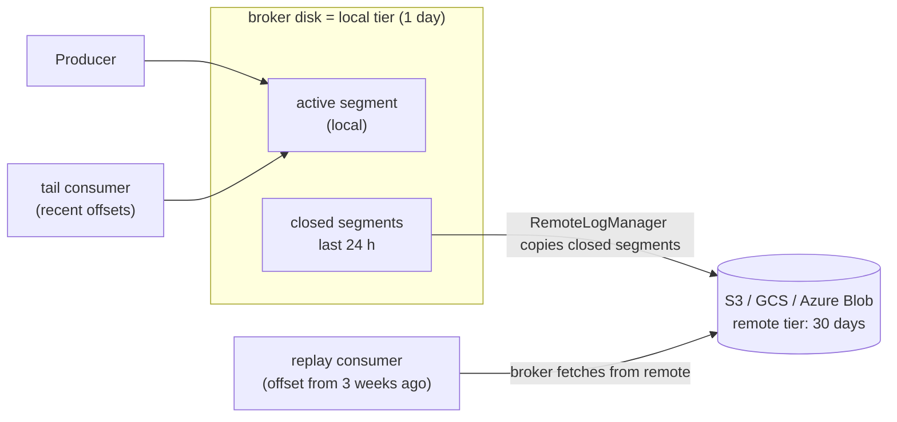

# 28 · Tiered storage (KIP-405)

**Definition:** **Tiered storage** keeps recent segments on broker disks (local tier) and moves closed segments to cheap object storage like S3 (remote tier); consumers read both transparently.

**Why it matters:** Retention stops being limited by broker disks. Months of history cost object-storage prices, and brokers stay small, so adding or replacing a broker copies only the local tier.

## Example

```
Initial data:
  ingest               : 50 MB/s, retention 30 days, RF 3
  local tier           : 1 day (local.retention.ms = 86400000)

Commands:
  create 28-audit-log with remote.storage.enable=true on this lab
                       : InvalidConfig "Tiered Storage functionality is disabled in the broker"
  capacity math        : 50 MB/s × 86,400 s = 4.32 TB per day

Result:
  broker disk without tiering : 4.32 × 30 × 3 = 388.8 TB
  broker disk with tiering    : 4.32 × 1 × 3  = 12.96 TB (96.7 % less)
  object storage              : 4.32 × 30 × 1 = 129.6 TB
```

## Diagram



| Config | Level | Meaning |
|---|---|---|
| `remote.log.storage.system.enable` | broker | Turn the feature on (needs a RemoteStorageManager plugin) |
| `remote.log.storage.manager.class.name` | broker | The plugin, e.g. an S3 implementation |
| `remote.storage.enable` | topic | Tier this topic |
| `local.retention.ms` / `local.retention.bytes` | topic | How long data stays on broker disk |
| `retention.ms` / `retention.bytes` | topic | Total retention (local + remote) |

## Code

[examples/28-tiered-storage/Program.cs](../examples/28-tiered-storage/Program.cs)

```csharp
var spec = new TopicSpecification
{
    Name = "28-audit-log",
    NumPartitions = 3,
    ReplicationFactor = 3,
    Configs = new()
    {
        ["remote.storage.enable"] = "true",
        ["local.retention.ms"] = "86400000",     // 1 day on broker disks
        ["retention.ms"] = "2592000000"          // 30 days in total (local + remote)
    }
};
```

Output (this lab has no remote-storage plugin, so the broker rejects the topic — the client side needs no change at all):

```text
create 28-audit-log -> InvalidConfig: Tiered Storage functionality is disabled in the broker. Topic cannot be configured with remote log storage.

ingest per day                 : 4.32 TB
broker disk, no tiering        : 4.32 TB x 30 days x RF 3 = 388.8 TB
broker disk, tiered (1 day)    : 4.32 TB x 1 day x RF 3  = 12.96 TB
object storage, tiered         : 4.32 TB x 30 days x 1   = 129.6 TB
broker disk saved              : 96.7 %
```

## ✅ Correct vs ❌ wrong usage

| | Usage | Reason |
|---|---|---|
| ✅ | Long-retention topics (audit, event sourcing, ML replay) | Cheap history, small brokers |
| ✅ | Short `local.retention.ms` + catch-up consumers tested for remote-read latency | Remote reads are slower (first byte from S3) |
| ❌ | Tiering compacted topics | Not supported (`cleanup.policy=compact` cannot be tiered) |
| ❌ | Expect lower latency for tail reads | Recent data is local either way |

## Pitfalls

1. Apache Kafka ships the framework, **not** an S3 plugin: you need a vendor or open-source RemoteStorageManager.
2. Disabling tiering on a topic later needs care (KIP-950); plan it as one-way.
3. Remote reads are paid per request: a consumer scanning months of data can cost real money.
4. Object storage bills by GB-month — keep the capacity math (above) in your design doc.

**Next:** [29 · Streams: windows & joins](29-streams-windows-joins.md)
