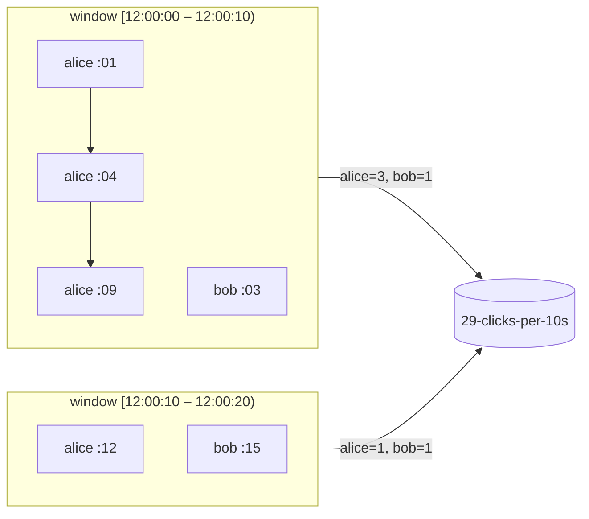
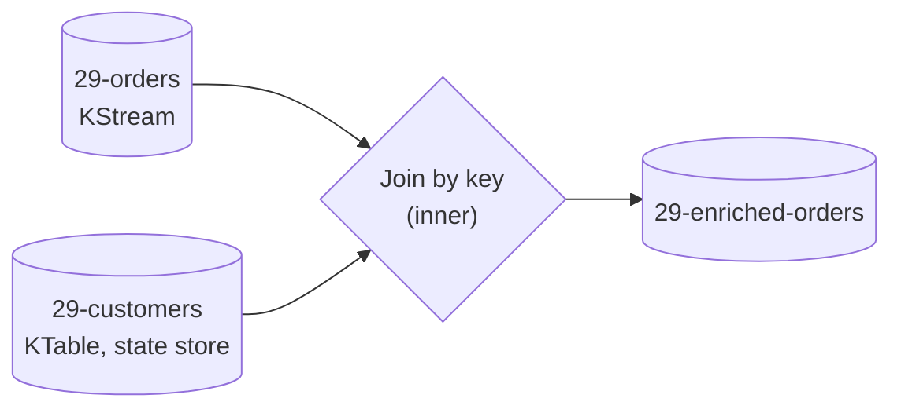

# 29 · Streams deep dive: windows & joins

**Definition:** A **window** groups records by **event time** into buckets (tumbling, hopping, sliding, session); a **join** combines two streams/tables by key — e.g. each order (KStream) with the customer's current tier (KTable).

**Why it matters:** "Clicks per user per minute" and "enrich orders with customer data" are the two most common stream-processing jobs; both depend on event time, co-partitioning and state stores.

## Example

```
Initial data:
  clicks (event time)  : alice @12:00:01, :04, :09, :12 · bob @12:00:03, :15
  customers (KTable)   : alice=gold, bob=silver → later bob=gold
  orders (KStream)     : alice order-1, carol order-2, bob order-3 (after bob → gold)

Commands:
  tumbling 10 s count  : alice [12:00:00-12:00:10) → 1, 2, 3 · [12:00:10-12:00:20) → 1
                         bob   [12:00:00-12:00:10) → 1      · [12:00:10-12:00:20) → 1
  order ⋈ customers    : alice → tier=gold · carol → dropped · bob → tier=gold

Result:
  windows              : by record timestamp, not by arrival time
  inner join           : carol has no customer row → no output
  table lookup         : uses the value at join time (bob was already gold)
```

## Diagram





| Window | Shape | Example |
|---|---|---|
| Tumbling | fixed, non-overlapping | clicks per 10 s |
| Hopping | fixed, overlapping (size 60 s, advance 10 s) | moving average |
| Sliding | time difference between records | "two events within 5 s" |
| Session | gap-based, per key | user sessions (30 min inactivity) |

| Join | Windowed? | Typical use |
|---|---|---|
| KStream–KStream | yes | match payment to order within 10 min |
| KStream–KTable | no | enrich event with current reference data |
| KTable–KTable | no | combine two changelogs |
| KStream–GlobalKTable | no, no co-partitioning needed | small reference data replicated to every instance |

## Code

[examples/29-streams-windows-joins/Program.cs](../examples/29-streams-windows-joins/Program.cs)

```csharp
builder.Stream<string, string>("29-clicks")
    .GroupByKey()
    .WindowedBy(TumblingWindowOptions.Of(TimeSpan.FromSeconds(10)))
    .Count(InMemoryWindows.As<string, long>("clicks-window-store"))
    .ToStream()
    .Map((window, count, _) => KeyValuePair.Create($"{window.Key}@{...StartMs}-{...EndMs}", count.ToString()))
    .To("29-clicks-per-10s");

var customers = builder.Table("29-customers", InMemory.As<string, string>("customers-store"));

builder.Stream<string, string>("29-orders")
    .Join(customers, (order, tier) => $"{order} (tier={tier})")
    .To("29-enriched-orders");
```

Output:

```text
== 29-clicks-per-10s
  alice@12:00:00-12:00:10  -> 1
  bob@12:00:00-12:00:10    -> 1
  alice@12:00:00-12:00:10  -> 2
  alice@12:00:00-12:00:10  -> 3
  alice@12:00:10-12:00:20  -> 1
  bob@12:00:10-12:00:20    -> 1
== 29-enriched-orders
  alice                    -> order-1 120 EUR (tier=gold)
  bob                      -> order-3 75 EUR (tier=gold)
```

## ✅ Correct vs ❌ wrong usage

| | Usage | Reason |
|---|---|---|
| ✅ | Set record timestamps at the source (event time) | Windows reflect when things happened |
| ✅ | Co-partition join inputs (same partitions, same key, same partitioner) | Otherwise records of a key meet in different tasks |
| ✅ | GlobalKTable for small reference data | No repartitioning |
| ❌ | Windowing by `DateTime.Now` inside a `Map` | Replays give different results |
| ❌ | Joining a .NET-produced topic (CRC32) with a Streamiz/Java one (murmur2) | Not co-partitioned ([07](07-keys-ordering.md)) |

## Pitfalls

1. Window results are **updates** (alice 1 → 2 → 3); use `Suppress` (until window close) if you need one final value.
2. Late records after the grace period are dropped silently.
3. A KStream–KTable join only triggers on the stream side; table updates alone emit nothing.
4. Window stores grow with window size × retention; size changelog topics accordingly.

**Next:** [30 · .NET hosting](30-background-service.md)
