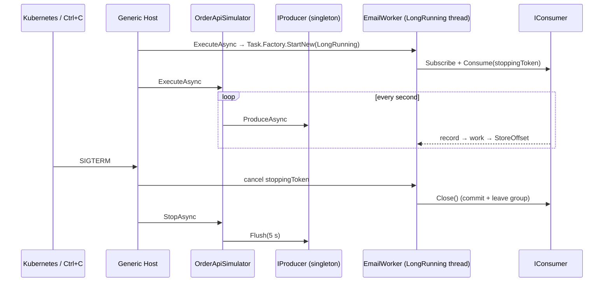
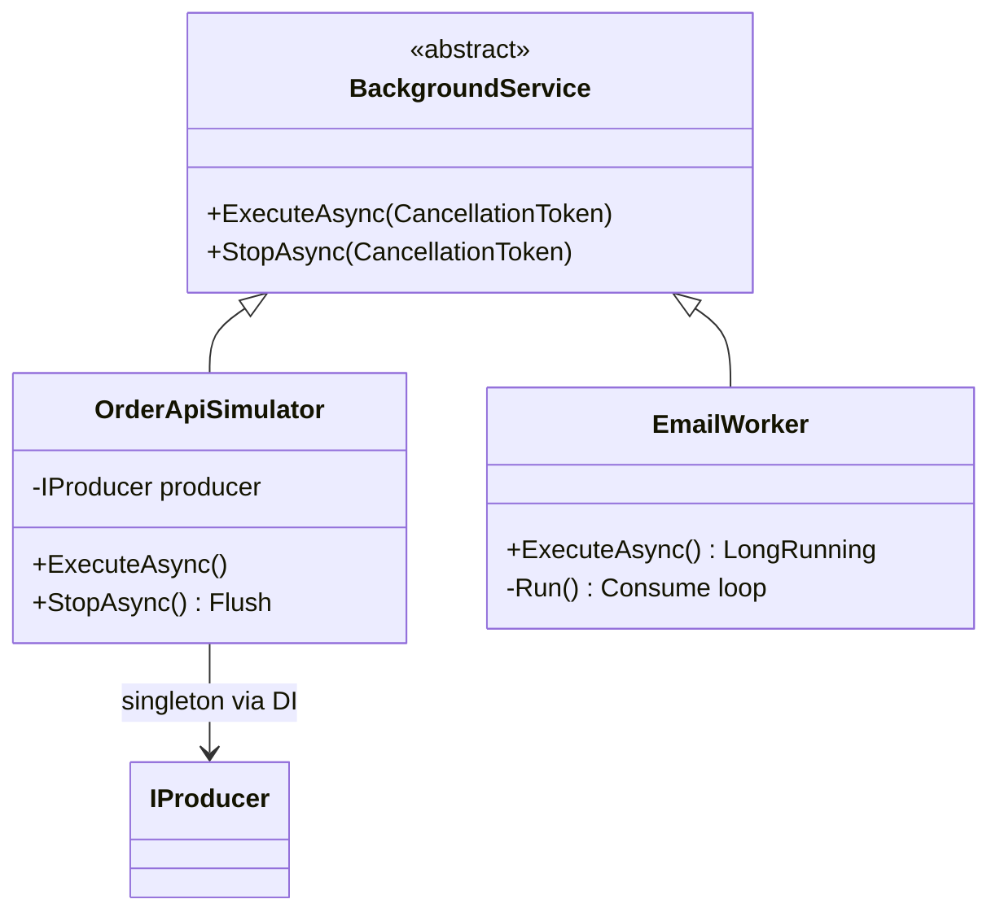

# 30 · Kafka in a .NET app: Generic Host & BackgroundService

**Definition:** In ASP.NET Core / Worker Service apps, Kafka clients live in the **Generic Host**: the producer is a DI **singleton**, each consumer loop is a **BackgroundService** on its own thread, and shutdown flushes and closes them.

**Why it matters:** Most production bugs with Kafka in .NET are hosting bugs: producers created per request, `Consume()` blocking app startup, and lost messages on `SIGTERM` during deploys.

## Example

Generic Host lifetime with a singleton producer and a `BackgroundService` consumer:

```
t=0 s   host start      EmailWorker subscribes → assigned 3 partitions
t=1..6  every 1 s       OrderApiSimulator publishes order-N → EmailWorker "sending email for order-N"
t=6 s   StopApplication()
          1. EmailWorker  "stop requested" → Close()  (commit offsets, leave group)
          2. producer     Flush → 0 left
                                                     published 6 · handled 6
```

## Diagram





## Code

[examples/30-background-service/Program.cs](../examples/30-background-service/Program.cs)

```csharp
// one producer for the whole app: thread-safe, keeps connections and batches
builder.Services.AddSingleton(_ => new ProducerBuilder<string, string>(new ProducerConfig { BootstrapServers = Lab.Bootstrap, EnableIdempotence = true }).Build());

builder.Services.AddHostedService<EmailWorker>();

sealed class EmailWorker(ILogger<EmailWorker> log) : BackgroundService
{
    protected override Task ExecuteAsync(CancellationToken stoppingToken) =>
        Task.Factory.StartNew(() => Run(stoppingToken), TaskCreationOptions.LongRunning);

    private void Run(CancellationToken stoppingToken)
    {
        // Subscribe, then: Consume(stoppingToken) → work → StoreOffset(record); finally Close()
    }
}
```

Output:

```text
11:15:24.507 info: OrderApiSimulator[0] published order-1 -> p1@2
11:15:24.548 info: EmailWorker[0] assigned 3 partition(s)
11:15:24.557 info: EmailWorker[0] sending email for order-1
11:15:25.547 info: EmailWorker[0] sending email for order-2
11:15:25.547 info: OrderApiSimulator[0] published order-2 -> p0@2
11:15:26.572 info: OrderApiSimulator[0] published order-3 -> p2@2
11:15:26.573 info: EmailWorker[0] sending email for order-3
11:15:27.593 info: EmailWorker[0] sending email for order-4
11:15:27.594 info: OrderApiSimulator[0] published order-4 -> p2@3
11:15:28.693 info: EmailWorker[0] sending email for order-5
11:15:28.695 info: OrderApiSimulator[0] published order-5 -> p1@3
11:15:29.729 info: OrderApiSimulator[0] published order-6 -> p0@3
11:15:29.730 info: EmailWorker[0] sending email for order-6
11:15:30.533 info: EmailWorker[0] stop requested
11:15:30.555 info: EmailWorker[0] consumer closed: offsets committed, left group
11:15:30.560 info: OrderApiSimulator[0] producer flushed, 0 message(s) left
```

## ✅ Correct vs ❌ wrong usage

| | Usage | Reason |
|---|---|---|
| ✅ | `IProducer` as singleton; inject it into controllers | One connection pool, batching across requests |
| ✅ | Consumer loop on a `LongRunning` task | `Consume()` blocks a thread; don't starve the thread pool |
| ✅ | `Close()` in `finally`, `Flush()` in `StopAsync` | No lost messages, fast rebalance on deploy |
| ✅ | Raise `HostOptions.ShutdownTimeout` above flush time | Default 30 s; Kubernetes `terminationGracePeriodSeconds` too |
| ❌ | `await Task.Run(consume loop)` directly in `ExecuteAsync` before the first `await` | Blocks host startup (other services never start) |
| ❌ | Unhandled exception in the loop | .NET 8+ stops the whole host by default (`BackgroundServiceExceptionBehavior.StopHost`) |

## Pitfalls

1. One consumer per BackgroundService; scale by running more pods, not more threads on one consumer.
2. Add a health check that fails when the loop stopped or lag keeps rising.
3. `Consume(stoppingToken)` throws `OperationCanceledException` on shutdown — that is the normal exit path.
4. Scoped services (DbContext) inside the loop: create a scope per record with `IServiceScopeFactory`.

**Next:** [31 · Debezium CDC](31-debezium-cdc.md)
