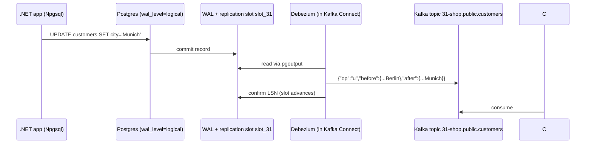

# 31 · Change data capture with Debezium

**Definition:** **Change data capture (CDC)** reads a database's transaction log and publishes every committed INSERT, UPDATE and DELETE as an event; **Debezium** is the standard set of Kafka Connect source connectors that do this.

**Why it matters:** No dual writes, no polling queries, no code in the app: the database log becomes the event stream. It also powers the outbox relay ([19](19-outbox-pattern.md)) in production.

## Example

Debezium reads the Postgres write-ahead log and turns each row change into an event on `31-shop.public.customers` (key = primary key):

| SQL | `op` | before | after |
|---|---|---|---|
| (existing row, snapshot) | r | – | 1, alice, Berlin |
| `INSERT (2, bob, Paris)` | c | – | 2, bob, Paris |
| `UPDATE … city = Munich WHERE id = 1` | u | 1, alice, Berlin | 1, alice, Munich |
| `DELETE WHERE id = 2` | d | 2, bob, Paris | null |
| (follow-up) | tombstone | key `{"id":2}`, value null | for compaction |

`before` is filled only because the table uses `REPLICA IDENTITY FULL`.

## Diagram



Event envelope (`value.converter.schemas.enable=false`):

| Field | Meaning |
|---|---|
| `op` | `r` snapshot read, `c` create, `u` update, `d` delete |
| `before` | row before the change (needs `REPLICA IDENTITY FULL` for all columns) |
| `after` | row after the change (`null` for delete) |
| `source` | db, table, LSN, txId, timestamp |
| key | primary key → same row always in the same partition |

## Code

[examples/31-debezium-cdc/Program.cs](../examples/31-debezium-cdc/Program.cs)

```bash
./connect/get-debezium.sh                 # downloads the plugin into connect/plugins
docker compose --profile cdc up -d        # postgres + connect
cd examples/31-debezium-cdc && dotnet run
```

```csharp
config = new Dictionary<string, string>
{
    ["connector.class"] = "io.debezium.connector.postgresql.PostgresConnector",
    ["database.hostname"] = "postgres",
    ["plugin.name"] = "pgoutput",
    ["slot.name"] = "slot_31",
    ["topic.prefix"] = "31-shop",
    ["table.include.list"] = "public.customers",
    ["value.converter"] = "org.apache.kafka.connect.json.JsonConverter",
    ["value.converter.schemas.enable"] = "false"
};

await Sql("UPDATE customers SET city = 'Munich' WHERE id = 1");
```

Output:

```text
POST /connectors -> 201
key={"id":1} op=r (snapshot) before=null after={"id":1,"name":"alice","city":"Berlin"}
key={"id":2} op=c (insert)   before=null after={"id":2,"name":"bob","city":"Paris"}
key={"id":1} op=u (update)   before={"id":1,"name":"alice","city":"Berlin"} after={"id":1,"name":"alice","city":"Munich"}
key={"id":2} op=d (delete)   before={"id":2,"name":"bob","city":"Paris"} after=null
key={"id":2} -> tombstone (lets compaction drop the key)
```

## ✅ Correct vs ❌ wrong usage

| | Usage | Reason |
|---|---|---|
| ✅ | Debezium on an **outbox table** + outbox event router SMT | Clean domain events instead of raw rows |
| ✅ | Key = primary key, compacted topic | Topic becomes the latest state of the table |
| ✅ | Monitor replication slot lag | An idle slot keeps WAL forever |
| ❌ | Publish raw table rows as your public API | Couples consumers to your schema |
| ❌ | Delete the connector and leave the slot | Postgres disk fills with WAL |

## Pitfalls

1. Replication slots retain WAL until Debezium confirms; a stopped connector can fill the DB disk (the example drops `slot_31` at the end).
2. Without `REPLICA IDENTITY FULL`, `before` contains only the key.
3. Schema changes (ALTER TABLE) flow into events; use Schema Registry ([10](10-serialization-schema-registry.md)) for consumers.
4. Initial snapshots of big tables take hours; plan `snapshot.mode`.

**Next:** [32 · MirrorMaker 2](32-mirrormaker-dr.md)
