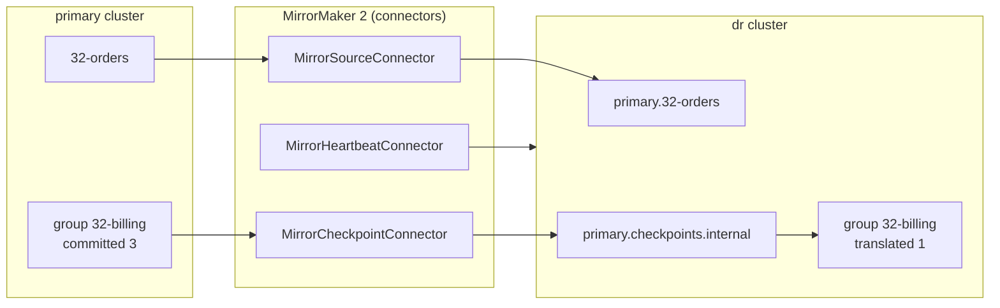

# 32 · MirrorMaker 2: multi-cluster & disaster recovery

**Definition:** **MirrorMaker 2 (MM2)** is a Kafka Connect–based tool that copies topics, configs and **translated consumer-group offsets** from one cluster to another (e.g. `primary` → `dr`).

**Why it matters:** A whole cluster or region can fail. MM2 keeps a warm copy so consumers can fail over and continue — if you understand what offset translation does and doesn't guarantee.

## Example

Group `32-billing-082141` committed offset 3 on the primary; MirrorMaker 2 translates it for the DR cluster conservatively:

```
primary  32-orders-082141      offset:  0     1     2     3     4
                                        o-1   o-2   o-3   o-4   o-5
                                        ✔     ✔     ✔     ▲ committed = 3

dr       primary.32-orders-082141       o-1   o-2   o-3   o-4   o-5
                                              ▲ translated = 1 (after 10 s and 120 s)

failover consumer on dr                       o-2   o-3   o-4   o-5
                                              └ dup ┘
```

Lost: 0. Duplicates: o-2, o-3. Consumers must be idempotent (doc 33).

## Diagram



| MM2 piece | Job |
|---|---|
| MirrorSourceConnector | copy records + topic configs; topic renamed `primary.<topic>` |
| offset-syncs | sparse "source offset X = target offset Y" markers (every `offset.lag.max`=100 records) |
| MirrorCheckpointConnector | translate group offsets using offset-syncs; write to target groups |
| MirrorHeartbeatConnector | heartbeats to measure replication lag / topology |

## Code

[examples/32-mirrormaker-dr/Program.cs](../examples/32-mirrormaker-dr/Program.cs) and [mirror/mm2.properties](../mirror/mm2.properties)

```properties
clusters = primary, dr
primary->dr.enabled = true
primary->dr.topics = 32-.*
primary->dr.groups = 32-.*
primary->dr.sync.group.offsets.enabled = true
```

```csharp
// failover: the same group starts on the DR cluster and continues where it stopped
var drConfig = new ConsumerConfig { BootstrapServers = "localhost:9292", GroupId = group, AutoOffsetReset = AutoOffsetReset.Earliest };

drConsumer.Subscribe($"primary.{topic}");
```

Run: `docker compose --profile dr up -d && cd examples/32-mirrormaker-dr && dotnet run`

Output:

```text
primary: billing processed o-1 (offset 0)
primary: billing processed o-2 (offset 1)
primary: billing processed o-3 (offset 2)
dr: after   5 s translated offset = -1001
dr: after  10 s translated offset = 1
dr topics: heartbeats, mm2-configs.primary.internal, mm2-offsets.primary.internal, mm2-status.primary.internal, primary.32-orders, primary.32-orders-082141, primary.checkpoints.internal, primary.heartbeats
dr: committed offset of 32-billing-082141 on primary.32-orders-082141 = 1
dr: billing processed o-2 (offset 1)
dr: billing processed o-3 (offset 2)
dr: billing processed o-4 (offset 3)
dr: billing processed o-5 (offset 4)
```

## ✅ Correct vs ❌ wrong usage

| | Usage | Reason |
|---|---|---|
| ✅ | Idempotent consumers before relying on failover | Translation rounds **down** → duplicates (see output) |
| ✅ | Lower `offset.lag.max` for tighter translation on low-volume topics | More offset-syncs, smaller duplicate window |
| ✅ | Run MM2 near the **target** cluster | Consuming remotely is safer than producing remotely |
| ❌ | Expect exactly-once across clusters | Replication is async; the last seconds can be lost |
| ❌ | Consumers on dr subscribing to `32-orders` | The mirrored name is `primary.32-orders` (or use `IdentityReplicationPolicy`) |

## Pitfalls

1. Async replication: RPO > 0 — records acknowledged on primary but not yet copied are lost if primary dies.
2. Offsets differ between clusters; never copy raw offsets yourself, use the translated ones.
3. Active-active needs the default prefix policy to avoid infinite loops.
4. Test failover AND failback regularly; failback is the hard half.

**Next:** [33 · Event-driven patterns](33-event-patterns.md)
