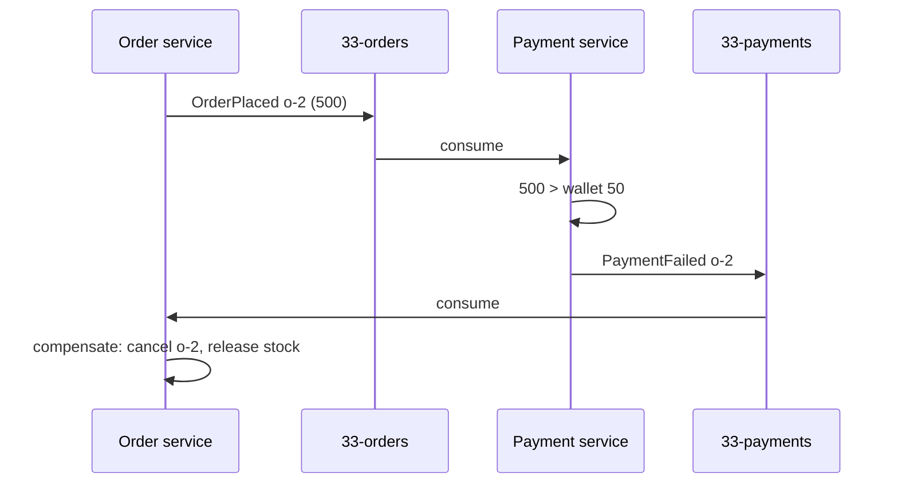
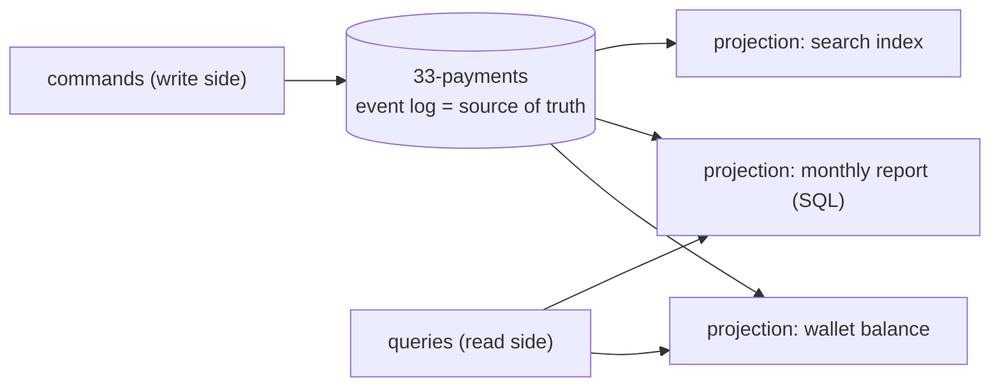

# 33 · Event-driven patterns: saga, idempotent consumer, event sourcing, CQRS

**Definition:** Patterns for building systems out of events: a **saga** coordinates a multi-service workflow with compensations, an **idempotent consumer** makes duplicates harmless, **event sourcing** stores state as the list of events, and **CQRS** builds separate read models from them.

**Why it matters:** Kafka gives at-least-once delivery and no distributed transactions across services. These patterns are how real systems stay correct anyway.

## Example

Wallet starts at 100 EUR. Events on `33-orders`, one is a redelivered duplicate:

| Event | Order | Payment service | Wallet | Order service |
|---|---|---|---|---|
| evt-1 | o-1, 50 | charge | 100 → 50 | CONFIRMED |
| evt-2 | o-2, 500 | 500 > 50 → PaymentFailed | 50 | CANCELLED (compensation) |
| evt-1 (dup) | o-1, 50 | event id seen → skip | 50 | – |
| evt-3 | o-3, 30 | charge | 50 → 20 | CONFIRMED |

Event sourcing check: replaying `33-payments` gives 100 − 50 − 30 = **20** = live wallet. No double charge.

## Diagram





| Pattern | Problem it solves | Kafka building block |
|---|---|---|
| Choreography saga | Multi-service workflow without 2PC | One topic per event type, compensating events |
| Orchestration saga | Same, with a central coordinator | Command + reply topics |
| Idempotent consumer | At-least-once duplicates | Event id header + processed-ids store |
| Event sourcing | Audit, rebuild state, time travel | Long-retention / tiered topics ([28](28-tiered-storage.md)) |
| CQRS | Different read shapes | Projections consuming the log |
| Outbox | DB + event atomicity | [19](19-outbox-pattern.md), [31](31-debezium-cdc.md) |

## Code

[examples/33-event-patterns/Program.cs](../examples/33-event-patterns/Program.cs)

```csharp
// idempotent consumer: dedupe by event id
if (!processed.Add(eventId))
{
    Console.WriteLine($"  {r.Message.Key}: duplicate {eventId} skipped (not charged twice)");

    continue;
}

// saga step: success or failure event; the order service compensates on failure
await Publish(payments, r.Message.Key, amount <= wallet ? $"PaymentSucceeded:{amount}" : $"PaymentFailed:{amount}", eventId: $"pay-{eventId}");

// event sourcing: state = fold over events
var rebuilt = 100 - ReadAll(payments).Where(r => r.Message.Value.StartsWith("PaymentSucceeded")).Sum(r => int.Parse(r.Message.Value.Split(':')[1]));
```

Output:

```text
== payment service (wallet 100 EUR)
  o-1: charged 50, wallet now 50
  o-2: 500 > wallet 50 -> PaymentFailed
  o-1: duplicate evt-1 skipped (not charged twice)
  o-3: charged 30, wallet now 20
== order service (saga outcome)
  o-1: CONFIRMED
  o-2: CANCELLED (compensation: release stock, notify customer)
  o-3: CONFIRMED
== event sourcing: wallet rebuilt from 3 payment events = 20 (live value 20)
```

## ✅ Correct vs ❌ wrong usage

| | Usage | Reason |
|---|---|---|
| ✅ | Store processed event ids in the **same DB transaction** as the side effect | Dedupe survives restarts |
| ✅ | Compensations are new events (`OrderCancelled`), never deletes | History stays auditable |
| ✅ | Key all events of one aggregate the same | Per-aggregate order ([07](07-keys-ordering.md)) |
| ❌ | In-memory `HashSet` for dedupe in production (as in this demo) | Lost on restart; use a table with TTL |
| ❌ | Synchronous HTTP chain between services "because it's simpler" | One slow service blocks all; no retry story |

## Pitfalls

1. Sagas are eventually consistent: the UI must show "pending" states.
2. Compensation can fail too — make it retryable and idempotent.
3. Event sourcing needs snapshots when an aggregate has thousands of events.
4. Changing event schemas in an event-sourced system is forever: version events ([10](10-serialization-schema-registry.md)).

**Next:** 🎉 Roadmap complete. Back to [README](../README.md).
