# .NET Examples — مفهوم واحد لكل مشروع

> 13 console app صغيرة (.NET 10 + Confluent.Kafka). كل وحدة `Program.cs` واحد بيوضّح فكرة وحدة من الـ [docs](../../docs).

```mermaid
flowchart LR
    A["01 Admin"] --> B["02 Producer"] --> C["03 Consumer"] --> D["04 Group"]
    D --> E["05 Keys"] --> F["06 Tuning"] --> G["07 Commits"]
    G --> H["08 DLQ"] --> I["09 Transactions"] --> J["10 Compaction"]
    J --> K["11 Replay"] --> L["12 Lag"] --> M["13 Event-Driven"]
```



## Run
```bash
docker compose -f docker/docker-compose.yml -p kafka-learn up -d   # من جذر الـ repo
cd examples/dotnet
dotnet build
dotnet run --project 01-Admin
```

## Map
| # | Project | المفهوم | Doc | Command |
|---|---|---|---|---|
| 01 | [01-Admin](01-Admin/Program.cs) | cluster, controller, leaders, ISR, configs | [03](../../docs/01-foundations/03-broker-cluster.md) [09](../../docs/02-replication/09-replication.md) | `dotnet run --project 01-Admin` |
| 02 | [02-Producer](02-Producer/Program.cs) | key, headers, partition/offset, async vs callback | [08](../../docs/01-foundations/08-record-anatomy.md) [11](../../docs/03-producer/11-producer-internals.md) | `dotnet run --project 02-Producer` |
| 03 | [03-Consumer](03-Consumer/Program.cs) | poll loop, auto commit, resume | [15](../../docs/04-consumer/15-consumer-poll-loop.md) | `dotnet run --project 03-Consumer` |
| 04 | [04-ConsumerGroup](04-ConsumerGroup/Program.cs) | rebalance, cooperative vs eager, static | [16](../../docs/04-consumer/16-consumer-groups.md) [17](../../docs/04-consumer/17-rebalancing.md) | `dotnet run --project 04-ConsumerGroup -- A [--eager] [--static]` |
| 05 | [05-KeysOrdering](05-KeysOrdering/Program.cs) | key → partition, murmur2 vs crc32 | [14](../../docs/03-producer/14-partitioning-keys.md) | `dotnet run --project 05-KeysOrdering` |
| 06 | [06-ProducerTuning](06-ProducerTuning/Program.cs) | acks × linger × compression benchmark | [11](../../docs/03-producer/11-producer-internals.md) [12](../../docs/03-producer/12-acks-durability.md) | `dotnet run -c Release --project 06-ProducerTuning` |
| 07 | [07-CommitSemantics](07-CommitSemantics/Program.cs) | at-most-once vs at-least-once (crash) | [19](../../docs/05-delivery-semantics/19-delivery-semantics.md) | see header of file |
| 08 | [08-RetryDlq](08-RetryDlq/Program.cs) | retry + backoff + DLQ | [24](../../docs/07-integration-patterns/24-error-handling-dlq.md) | `dotnet run --project 08-RetryDlq` |
| 09 | [09-Transactions](09-Transactions/Program.cs) | commit/abort, read_committed, EOS | [20](../../docs/05-delivery-semantics/20-transactions-eos.md) | `dotnet run --project 09-Transactions` |
| 10 | [10-Compaction](10-Compaction/Program.cs) | latest value per key, tombstones | [21](../../docs/06-storage/21-retention-compaction.md) | `dotnet run --project 10-Compaction` |
| 11 | [11-SeekReplay](11-SeekReplay/Program.cs) | seek by offset / timestamp | [07](../../docs/01-foundations/07-offsets.md) | `dotnet run --project 11-SeekReplay` |
| 12 | [12-LagMonitor](12-LagMonitor/Program.cs) | lag = end − committed | [29](../../docs/08-operations/29-monitoring.md) | `dotnet run --project 12-LagMonitor -- demo-reader` |
| 13 | [13-EventDriven](13-EventDriven/Program.cs) | API + 2 services (fan-out) | [36](../../docs/10-wrap-up/36-use-cases.md) | `-- api` / `-- inventory` / `-- notification` |

## 07 — Crash scenarios
```bash
dotnet run --project 07-CommitSemantics -- seed
dotnet run --project 07-CommitSemantics -- after --crash 5   # then: -- after   → pay-5 twice
dotnet run --project 07-CommitSemantics -- reset
dotnet run --project 07-CommitSemantics -- before --crash 5  # then: -- before  → pay-5 lost
```

## Run inside Docker (scale out)
```bash
# any example as an image; bootstrap comes from KAFKA_BOOTSTRAP
docker build -f examples/dotnet/Dockerfile --build-arg PROJECT=13-EventDriven -t kafka-example-13 examples/dotnet
docker compose -f docker/docker-compose.yml -f docker/docker-compose.scale.yml -p kafka-learn up -d --scale inventory=3 inventory
```
→ [docs/38](../../docs/09-scaling/34-scaling-consumers-partitions.md)

## Structure
```text
examples/dotnet/
├── Directory.Build.props   # net10.0 + Confluent.Kafka for all projects
├── Common/Cluster.cs       # bootstrap servers, EnsureTopicAsync, Ctrl+C token
├── KafkaExamples.sln
└── NN-Name/Program.cs      # one concept each
```

## Troubleshooting
| Symptom | Cause | Fix |
|---|---|---|
| `Local: Timed out` on first run | cluster still electing controller | `docker ps` → wait until all 3 brokers are Up |
| `Coordinator load in progress` warning | `__consumer_offsets` being created (first time only) | ignore, retries automatically |
| consumer prints nothing after a crash | dead member still owns partitions | wait `session.timeout.ms` ([15](../../docs/04-consumer/15-consumer-poll-loop.md)) |
